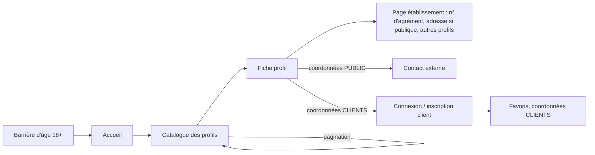
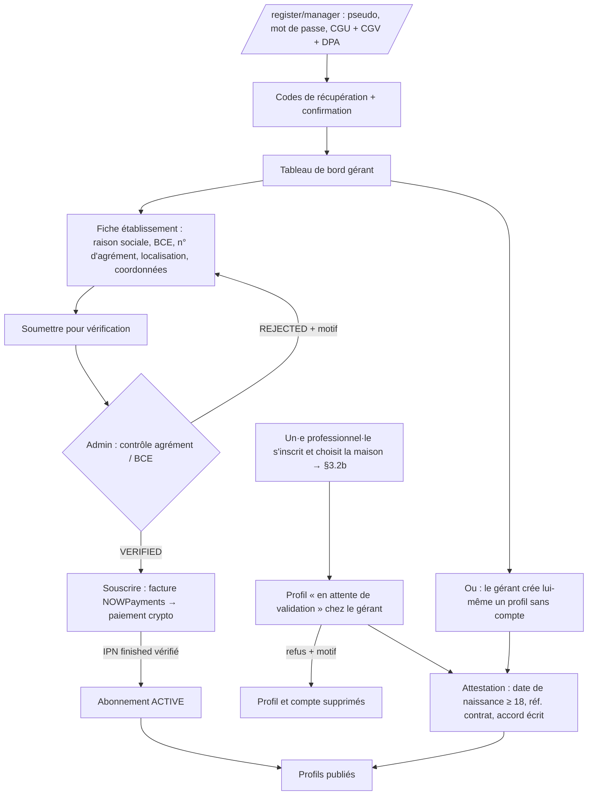
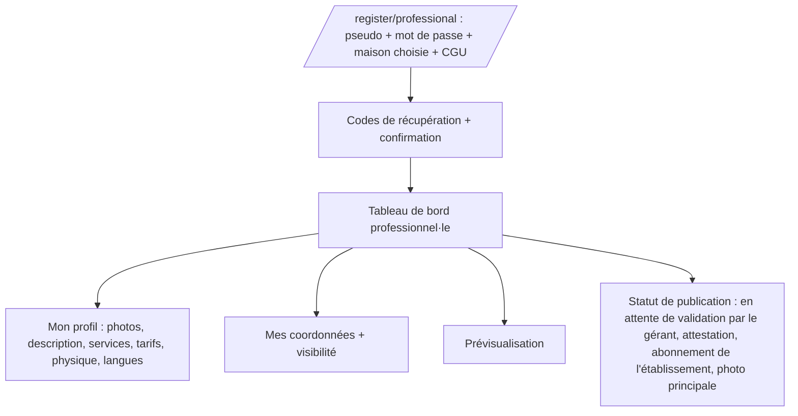
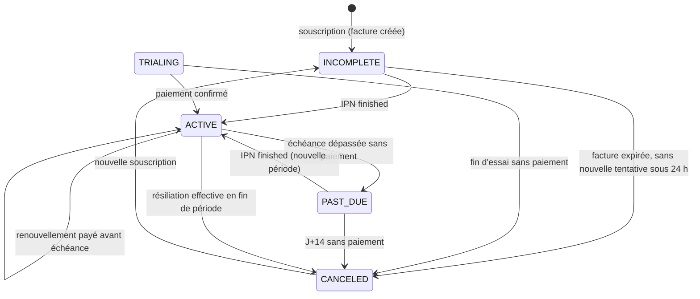
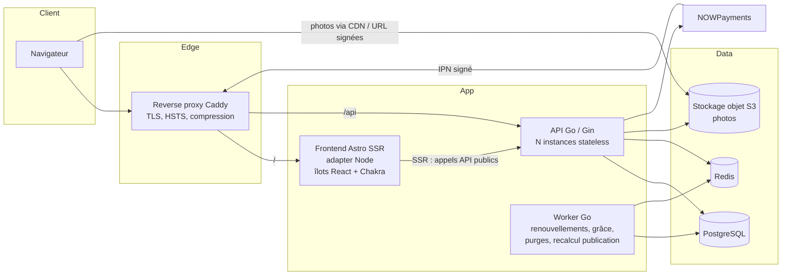
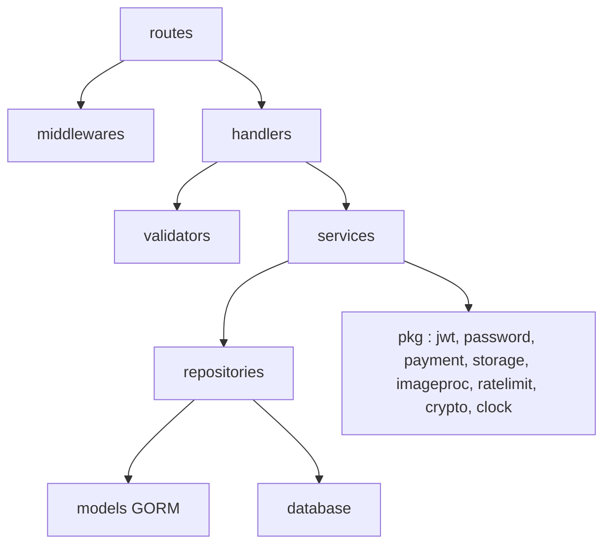
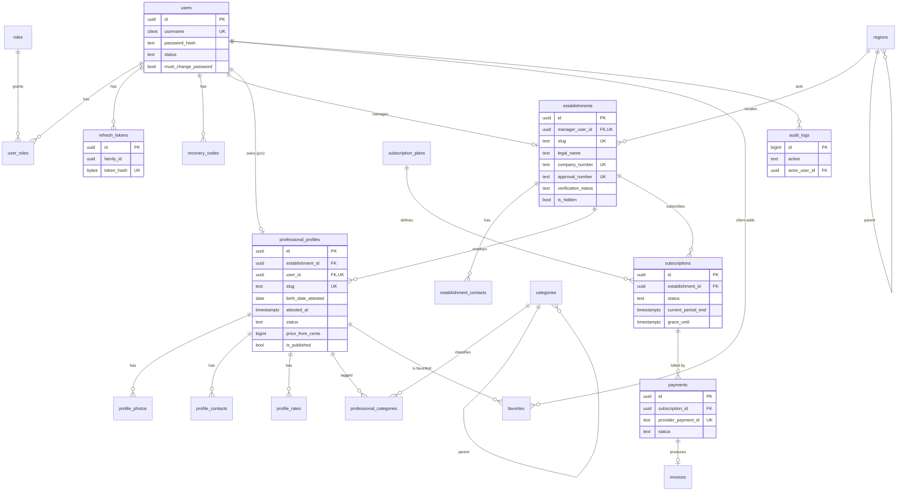
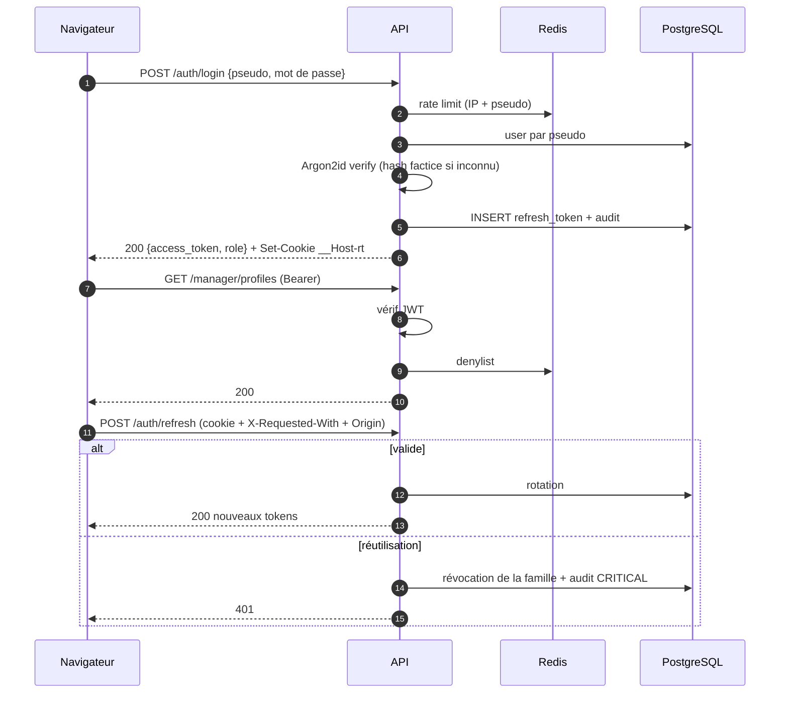
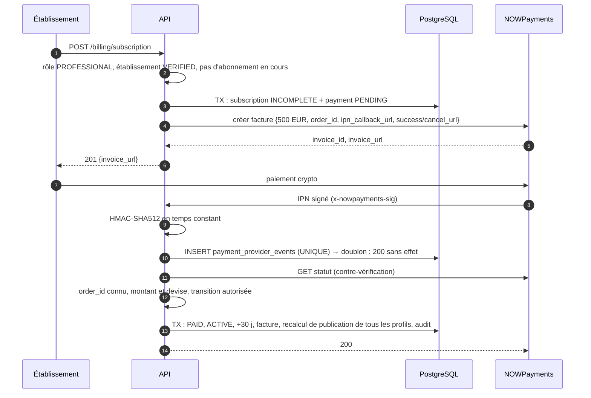

# Dossier de conception — Plateforme SaaS de présentation d'établissements agréés et de leurs professionnel·les (Belgique)

> **Statut** : v2.2 — Phases 1 & 2 — *en attente de validation (Phase 3)*
> **Date** : 2026-11-02
> **Portée** : document de référence officiel. Toute déviation doit être justifiée, proposée, puis consignée dans le [journal des décisions](#20-journal-des-décisions-adr) avant implémentation.
>
> **Historique**
> - v1.0 : première version (annuaire de professionnel·les indépendant·es, Stripe).
> - v1.1 : NOWPayments remplace Stripe ; plus de TOTP/2FA ; admin créé au démarrage de l'API.
> - v1.2 : contexte belge ; KYC externe, signalements et modération a priori retirés.
> - v1.3 : suppression de tout ce qui concerne l'e-mail.
> - **v2.0** : réponses aux questions Q-1 à Q-3. **L'établissement (la maison) est l'abonné payant**, il publie **un ou plusieurs profils** de ses **salarié·es**, et le catalogue est **public**. Réécriture complète pour la cohérence.
> - **v2.1** : hypothèses confirmées ou corrigées. **Plusieurs maisons** sur la plateforme. **Quatre rôles** : `ADMIN` (administrateurs de la plateforme), `MANAGER` (compte gérant de la maison, qui voit et gère tous ses professionnel·les), `PROFESSIONAL` (compte propre à chaque professionnel·le), `CLIENT`. Un client qui a perdu ses codes recrée un compte (ADR-016).
> - **v2.2** : pas de code d'invitation (H-5 refusée) ; un·e professionnel·le s'inscrit en choisissant sa maison, son profil reste `PENDING_APPROVAL` jusqu'à l'attestation du gérant, qui peut aussi refuser. H-6 (le gérant modifie les profils, avec traçabilité) et H-7 (attestation, activation, archivage et suppression réservés au gérant) sont validées.

---

## Sommaire

0. [Contexte et prérequis](#0-contexte-et-prérequis)
1. [Analyse fonctionnelle](#1-analyse-fonctionnelle)
2. [Règles métier](#2-règles-métier)
3. [Parcours utilisateurs](#3-parcours-utilisateurs)
4. [Architecture globale](#4-architecture-globale)
5. [Architecture backend](#5-architecture-backend)
6. [Architecture frontend](#6-architecture-frontend)
7. [Arborescence des dossiers](#7-arborescence-des-dossiers)
8. [Modèle de données PostgreSQL](#8-modèle-de-données-postgresql)
9. [Diagramme ERD](#9-diagramme-erd)
10. [Matrice RBAC](#10-matrice-rbac)
11. [Liste des endpoints REST](#11-liste-des-endpoints-rest)
12. [Stratégie d'authentification et JWT](#12-stratégie-dauthentification-et-jwt)
13. [Stratégie de sécurité](#13-stratégie-de-sécurité)
14. [Intégration paiements — NOWPayments](#14-intégration-paiements--nowpayments)
15. [Infrastructure, environnements, sauvegardes](#15-infrastructure-environnements-sauvegardes)
16. [Stratégie de tests](#16-stratégie-de-tests)
17. [Choix techniques justifiés](#17-choix-techniques-justifiés)
18. [Risques et solutions](#18-risques-et-solutions)
19. [Plan de développement (tâches vérifiables)](#19-plan-de-développement-tâches-vérifiables)
20. [Journal des décisions (ADR)](#20-journal-des-décisions-adr)
21. [Incohérences, hypothèses et questions](#21-incohérences-hypothèses-et-questions)

---

## 0. Contexte et prérequis

### 0.1 Contexte (décisions du porteur du projet, 2026-11-02)

| Question | Réponse | Traduction dans la conception |
|---|---|---|
| Q-1 — Qui paie les 500 €/mois ? | **La maison** paie l'éditeur ; **plusieurs maisons** sur la plateforme | L'abonné est l'**établissement** (relation B2B). Les professionnel·les ne paient rien. Modèle **multi-établissements** |
| Q-2 — Qui voit le catalogue ? | **Tout le monde** | Catalogue et fiches publics ; inscription client libre ; coordonnées soumises à la visibilité choisie (RM-40) |
| Q-3 — Statut des professionnel·les ? | **Salarié·es** ; une maison a **une ou plusieurs** professionnel·les | Chaque professionnel·le a **son propre compte** (`PROFESSIONAL`), rattaché à une maison. La maison a **un compte gérant** (`MANAGER`) qui voit et gère l'ensemble de ses professionnel·les. Loi du 3 mai 2024 : la maison doit être agréée |

**Vocabulaire et rôles**

| Rôle | Qui | Portée |
|---|---|---|
| `ADMIN` | Administrateurs de la **plateforme** (l'éditeur) | Toute la plateforme |
| `MANAGER` | **Compte gérant** d'une maison (un par établissement) | Son établissement : fiche, abonnement, factures, **tous** ses professionnel·les |
| `PROFESSIONAL` | **Un·e professionnel·le** salarié·e d'une maison | **Son propre** profil uniquement |
| `CLIENT` | Visiteur inscrit | Ses favoris et son compte |

- **Établissement** : la maison (personne morale agréée), représentée par son compte gérant.
- **Profil** : la fiche publique d'un·e professionnel·le. Un compte `PROFESSIONAL` = un profil = un établissement.
- Le cahier des charges prévoyait trois rôles ; le quatrième (`MANAGER`) découle de la réponse du porteur du projet (ADR-016).

### 0.2 Cadre juridique (Belgique)

| Point | Constat | Conséquence pour le projet |
|---|---|---|
| **Réforme de 2022** | Depuis le 1er juin 2022, la Belgique a dépénalisé le travail du sexe et les tiers qui le facilitent. L'exploitation et la traite restent des infractions ([Brussels Times](https://brusselstimes.com/211351/historic-reform-belgium-first-in-europe-to-officially-decriminalise-sex-work), [Violett](https://www.violett.be/en/sexworkers/sex-work-in-belgium/legislation/)) | Activité possible dans un cadre précis |
| **Loi du 3 mai 2024 (en vigueur depuis le 1er décembre 2024)** | Seuls les employeurs **agréés** (personne morale) peuvent occuper des travailleur·ses du sexe sous contrat de travail ; sans agrément, l'employeur s'expose à des poursuites pour proxénétisme. Le contrat doit être **écrit**, établi pour chaque travailleur·se, mentionner le **numéro d'agrément**, et le ou la travailleur·se doit être **majeur·e** ([SPF Emploi](https://emploi.belgique.be/fr/themes/contrats-de-travail/contrats-de-travail-particuliers/contrat-de-travail-de-travailleur-du), [Partena](https://www.partena-professional.be/fr/node/21590)) | Un établissement n'est publié qu'après la **vérification de son agrément par l'admin** (RM-11). Le numéro d'agrément est **affiché** sur ses pages. Pour chaque profil, le **gérant** (l'employeur) **atteste** l'âge et le contrat (RM-21) |
| **Facturation** | L'établissement paie un éditeur de logiciel : c'est une relation commerciale B2B classique. Aucun prélèvement n'est fait sur les travailleur·ses | Le risque d'« exploitation » lié à la facturation (v1.2) est **levé** |
| **Publicité** | Selon les sources consultées, la publicité pour le travail du sexe est autorisée sur des supports dédiés et sous conditions, et interdite ailleurs ; les sources ne s'accordent pas sur le détail | La plateforme est un support dédié. Les conditions précises (mentions, contenus permis, catalogue public) restent **à valider par un avocat belge** (T0.1) |
| **RGPD** | L'établissement publie des données de ses salarié·es, dont certaines touchent à la vie sexuelle (art. 9). Il est **responsable de traitement** pour ces données ; l'éditeur est **sous-traitant** (art. 28). Dans une relation de travail, le consentement du salarié est juridiquement fragile | **Contrat de sous-traitance (DPA)** dans les CGV ; attestation de l'accord écrit de chaque salarié·e (RM-21) ; base légale à confirmer par l'avocat ; AIPD |

**Décision** : le développement avance. La mise en production reste conditionnée à l'**avis d'un avocat belge** (T0.1).

### 0.3 Prestataire de paiement

- **Stripe interdit** les services pour adultes ([Stripe — Restricted businesses](https://stripe.com/legal/restricted-businesses)). **NOWPayments** (crypto) le remplace (ADR-002).
- **À confirmer par écrit avec NOWPayments (T0.2)** : l'acceptation de l'activité (la plateforme facture des établissements du secteur), les exigences KYB marchand, la conversion en EUR, et la possibilité de créer une facture **sans e-mail client**.
- Le paiement est isolé derrière une interface **`PaymentProvider`** (§5.4), ce qui permet de changer de prestataire sans toucher au métier.

---

## 1. Analyse fonctionnelle

### 1.1 Acteurs

| Acteur | Rôle technique | Description | Connexion |
|---|---|---|---|
| **Visiteur** | — | Consulte le catalogue, les fiches et les pages établissement ; voit les coordonnées `PUBLIC` | Non |
| **Client** | `CLIENT` | Compte gratuit : favoris, coordonnées `CLIENTS`, espace personnel | Oui |
| **Gérant** | `MANAGER` | Compte de la maison : fiche établissement, validation des professionnel·les qui s'y rattachent, vue et gestion de **tous** leurs profils, attestations, abonnement, factures | Oui |
| **Professionnel·le** | `PROFESSIONAL` | Salarié·e d'une maison, inscrit·e librement en choisissant sa maison : gère **son propre** profil (photos, description, services, tarifs, physique, coordonnées et visibilité, prévisualisation) et voit le statut de publication | Oui |
| **Admin** | `ADMIN` | Administrateurs de la plateforme : vérification des établissements, gestion des comptes, masquage, abonnements, statistiques, catégories, régions, audit. Créé uniquement par le *bootstrap* au démarrage de l'API | Oui |
| **Systèmes externes** | — | NOWPayments (paiements + IPN), stockage objet S3 (photos). **Aucun service d'e-mail** | — |

### 1.2 Fonctionnalités

| # | Domaine | Fonctionnalités | Priorité |
|---|---|---|---|
| F1 | Public | Accueil, navigation, catalogue paginé des profils, recherche par région/ville, filtres (physique, services, âge, prix, établissement), fiche profil, page établissement | MVP |
| F2 | Auth | Inscription gérant, professionnel·le (avec choix de la maison) et client (pages distinctes), connexion par pseudo, déconnexion, refresh, codes de récupération, réinitialisation par l'admin, sessions ; **pas d'e-mail** | MVP |
| F3 | Gérant | Fiche établissement (nom, raison sociale, n° BCE, n° d'agrément, localisation, adresse facultative, coordonnées, horaires, description), soumission pour vérification ; vue d'ensemble et gestion de tous les profils (modifier, attester, activer, archiver, **refuser** un rattachement, suspendre le compte d'un·e professionnel·le, réinitialiser son mot de passe) | MVP |
| F4 | Professionnel·le | Gestion de **son propre** profil : photos, description, services, tarifs, physique, langues, coordonnées et visibilité, prévisualisation, statut de publication, compte | MVP |
| F5 | Abonnement | Souscription par le gérant pour l'établissement, paiement crypto, renouvellement mensuel, rappels dans l'application, historique, factures, résiliation, impayés | MVP |
| F6 | Client | Espace personnel, favoris, gestion du compte, suppression | MVP |
| F7 | Admin | Utilisateurs, établissements (vérification de l'agrément), profils, clients, suspension/réactivation, masquage/suppression d'un profil ou d'un établissement, abonnements, paiements, stats, catégories, régions, audit, événements de sécurité | MVP |
| F8 | Sécurité | Rate limiting, audit, en-têtes, admin créé au démarrage, mesures compensatoires sans 2FA (§13.6) | MVP |
| F9 | Conformité | Acceptation versionnée des CGU/CGV/DPA, mentions d'agrément, export/suppression des données, barrière d'âge visiteurs | MVP |

### 1.3 Hors périmètre MVP

Plusieurs comptes gérants par établissement, transfert d'un·e professionnel·le d'une maison à une autre (on archive et on recrée), messagerie interne, avis/notations, réservation en ligne, application mobile, multilingue (préparé, pas traduit), mise en avant payante, essai gratuit (le statut `TRIALING` est néanmoins supporté).

### 1.4 Dépendances externes

| Dépendance | Usage | Criticité | Mitigation |
|---|---|---|---|
| NOWPayments | Paiements crypto, IPN | Haute | Interface `PaymentProvider` |
| Stockage S3-compatible | Photos | Haute | MinIO en dev, tout S3 en prod |
| Redis | Rate limiting partagé, denylist | Haute | Requis dès le multi-instance |
| PostgreSQL | Données | Critique | Réplication + PITR |

---

## 2. Règles métier

### 2.1 Comptes

- **RM-01** — Un compte possède **un seul rôle** : `CLIENT`, `MANAGER` ou `PROFESSIONAL`. Le rôle est fixé **par l'endpoint d'inscription** (`/register/client`, `/register/manager` ; le compte `PROFESSIONAL` est créé par le gérant, ADR-022), **jamais** par un champ envoyé par le frontend. Un champ `role` présent dans la requête est ignoré et journalisé comme événement de sécurité.
- **RM-01b — Remplacée (ADR-022)** : les professionnel·les ne s'inscrivent plus. Le gérant crée chaque profil et, s'il le souhaite, ses identifiants (pseudo + mot de passe) ; la professionnelle se connecte sur `/pro/login` et arrive dans l'espace de sa maison. Texte historique : la personne s'inscrit sur `/register/professional` avec un pseudo, un mot de passe et **la maison choisie** dans la liste des établissements `VERIFIED`. Le serveur crée le compte `PROFESSIONAL` et un profil `DRAFT` rattaché à cette maison. **Rien n'est publié** tant que le gérant n'a pas fait l'attestation (RM-21, réservée au gérant) : c'est cette attestation qui vaut acceptation. Le profil apparaît dans le tableau de bord du gérant comme « **en attente de validation** ». Le gérant peut :
  - **attester**, ce qui accepte la personne (puis activation et publication selon RM-22) ;
  - **refuser**, ce qui supprime le profil et le compte (la personne ne travaille pas dans la maison), avec un motif et un audit.
  Tant qu'il n'est pas attesté, un compte professionnel ne voit que son propre profil et le nom public de la maison ; il n'a accès à aucune autre donnée de l'établissement. Pour limiter le spam, l'inscription est limitée en débit, et une maison ne peut avoir plus de 20 profils en attente (paramètre `max_pending_profiles`). Le rattachement est définitif : pour changer de maison, il faut créer un nouveau compte.
- **RM-02** — Le rôle `ADMIN` (administrateurs de la plateforme) n'est attribuable **que par le bootstrap au démarrage de l'API**. Aucun endpoint ne permet d'attribuer ou de retirer ce rôle. `ADMIN_BOOTSTRAP_USERS_FILE` permet de déclarer **plusieurs administrateurs** (un pseudo et un fichier de mot de passe par entrée), chacun créé selon RM-02b.
- **RM-02b — Bootstrap admin** : avant d'ouvrir le port HTTP, l'API exécute `EnsureBootstrapAdmin` :
  1. si `ADMIN_BOOTSTRAP_USERNAME` n'est pas défini → rien n'est fait ;
  2. l'opération se fait sous un **verrou consultatif PostgreSQL**, pour que plusieurs instances ne créent pas de doublon ;
  3. si le pseudo existe déjà → **aucune modification**. Si ce compte n'est pas `ADMIN`, le **démarrage échoue** : on ne peut pas promouvoir un compte existant ;
  4. sinon → création du compte `ADMIN` `ACTIVE`, mot de passe en Argon2id, `must_change_password = true`, audit `admin.bootstrap.created`.
  Le mot de passe doit faire au moins 16 caractères ; sinon le démarrage échoue. En staging et en prod, il est lu **uniquement depuis un fichier de secret** (`ADMIN_BOOTSTRAP_PASSWORD_FILE`).
- **RM-02c** — Tant que `must_change_password` est vrai, le compte (admin ou autre) n'accède qu'à `PUT /auth/password`, `GET /auth/me` et `POST /auth/logout`.
- **RM-03** — Pseudo unique insensible à la casse (`citext`), 3 à 30 caractères `[a-zA-Z0-9_.-]`, liste de pseudos réservés.
- **RM-04** — **Aucune adresse e-mail n'est collectée ni stockée** (ADR-014). À l'inscription, chaque utilisateur reçoit **10 codes de récupération à usage unique**. Ils sont affichés une seule fois, téléchargeables, et l'utilisateur doit confirmer qu'il les a enregistrés.
- **RM-05** — Mot de passe : 12 à 128 caractères (16 minimum pour les admins), vérifié contre une liste de mots de passe compromis (k-anonymity HIBP, avec repli sur une liste locale). Pas de règles de composition (NIST 800-63B).
- **RM-06** — Statuts de compte : `ACTIVE`, `SUSPENDED`, `DELETED` (suppression logique, purge à 30 jours). La suspension révoque immédiatement toutes les sessions.
- **RM-07 — Perte du mot de passe et des codes** : une réinitialisation produit un **mot de passe temporaire à usage unique** (20 caractères, affiché une seule fois), révoque toutes les sessions, impose le changement de mot de passe, et est auditée avec un motif.
  - **Professionnel·le** : réinitialisation par **son gérant**, remise en personne à la maison.
  - **Gérant** : réinitialisation par un **admin**, après un rappel au numéro de vérification de l'établissement (procédure écrite, T8.3).
  - **Client** : seuls les codes permettent de récupérer le compte. À défaut, le client **crée un nouveau compte** avec de nouveaux identifiants (décision du porteur du projet ; les favoris de l'ancien compte sont perdus).

### 2.2 Établissements

- **RM-10** — Un compte `MANAGER` = **un établissement** (contrainte d'unicité ; un seul gérant par établissement en MVP). L'établissement est créé, vide (`DRAFT`), à l'inscription du gérant. Champs : nom commercial, raison sociale, n° d'entreprise (BCE), **n° d'agrément** (loi du 3 mai 2024), région et ville, adresse (facultative, avec choix d'affichage public), description, horaires, coordonnées avec visibilité (RM-40).
- **RM-11 — Vérification de l'établissement par l'admin** : le gérant remplit la fiche puis la soumet (`verification_status = PENDING`). L'admin contrôle le n° BCE et le n° d'agrément (registre ou document fourni hors plateforme), puis **approuve** (`VERIFIED`, `verified_at`, `verified_by`) ou **refuse** avec un motif (`REJECTED`). Un changement ultérieur du n° d'agrément, de la raison sociale ou du n° BCE repasse l'établissement en `PENDING` : ses profils sont dépubliés jusqu'à la nouvelle approbation.
- **RM-12** — Le n° d'agrément et la raison sociale sont **affichés** sur la page de l'établissement et sur chaque fiche profil.
- **RM-13** — Un établissement peut publier un **nombre illimité** de profils, sauf si le plan définit `max_active_profiles` (paramètre en base, NULL = illimité).

### 2.3 Profils (professionnel·les)

- **RM-20 — Propriété des profils** : un profil appartient à **un établissement** (`establishment_id`) et, s'il a été créé par l'inscription d'un·e professionnel·le, à **un compte professionnel** (`user_id`, unique). Les droits sont les suivants (contrôlés dans les services, §5.1) :
  - le **professionnel·le** lit et modifie **uniquement son propre profil** (contenu, photos, services, tarifs, physique, coordonnées et visibilité) ;
  - le **gérant** voit et gère **tous** les profils de **son** établissement : il peut **modifier leur contenu** (H-6 validée ; chaque modification est tracée avec son auteur), attester, activer, archiver, supprimer, refuser un rattachement, suspendre ou réactiver le compte professionnel associé, et réinitialiser son mot de passe ;
  - aucun professionnel·le ni gérant n'a accès aux profils d'un autre établissement.
  Un gérant peut aussi créer lui-même un profil **sans compte professionnel** (`user_id` NULL) et le gérer seul.
- **RM-21 — Retirée (ADR-021)** : l'attestation d'âge et de contrat par le gérant n'est plus exigée. La publication dépend désormais de l'abonnement et de l'acceptation du rattachement par la maison (RM-01b), sans vérification d'âge.
  *Ancien texte, pour mémoire :* seul le **gérant** (l'employeur) peut la faire ; un·e professionnel·le ne peut pas s'attester elle-même ou lui-même. Le gérant saisit la **date de naissance** relevée sur la pièce d'identité (le serveur vérifie **≥ 18 ans**), la **référence interne du contrat de travail**, puis coche une attestation datée : « identité et âge vérifiés sur pièce, contrat de travail en cours, accord écrit de la personne pour cette publication ». Aucune pièce d'identité ni copie de contrat n'est stockée. L'attestation est horodatée, liée au compte qui l'a faite et auditée.
- **RM-22** — Un profil est **publié** si et seulement si **toutes** ces conditions sont vraies :
  1. compte gérant `ACTIVE` et, si le profil est lié à un compte professionnel, ce compte `ACTIVE` ;
  2. établissement `VERIFIED` (RM-11) et non masqué ;
  3. abonnement de l'établissement donnant droit : `ACTIVE`, `TRIALING`, ou `PAST_DUE` pendant la période de grâce ;
  4. profil `ACTIVE` (ni brouillon ni archivé), attestation RM-21 présente ;
  5. profil non masqué par l'admin ;
  6. au moins une photo principale ;
  7. quota `max_active_profiles` respecté, s'il est défini.
  Le service calcule et stocke `is_published` à chaque changement d'une de ces conditions, et une tâche nocturne recalcule l'ensemble.
- **RM-23** — L'**âge affiché** est calculé à partir de la date de naissance attestée ; la date elle-même n'est jamais exposée publiquement.
- **RM-24** — Les modifications d'un profil, par le professionnel·le ou le gérant, sont **visibles immédiatement** (pas de modération a priori) et auditées avec l'auteur. Le gérant peut **archiver** un profil, par exemple à la fin d'un contrat : le profil est alors dépublié, l'attestation invalidée et le compte professionnel associé **suspendu** (sessions révoquées). L'admin peut **masquer** un profil ou retirer une photo (motif obligatoire, audit).
- **RM-25** — Tarifs : 1 à 15 lignes (prestation/durée + montant en EUR) ; `price_from_cents` (minimum) est dénormalisé pour le filtre et le tri.
- **RM-26** — Photos : 1 principale obligatoire, 12 maximum. JPEG/PNG/WebP, 10 Mo maximum, ré-encodées côté serveur, **métadonnées EXIF supprimées** (dont le GPS).
- **RM-27** — La localisation d'un profil est **celle de son établissement** (pas de saisie séparée).

### 2.4 Abonnements (payés par l'établissement, gérés par le gérant)

Seul le **gérant** souscrit, paie, résilie et consulte les factures. Le ou la professionnel·le voit seulement si son profil est publié, et pourquoi il ne l'est pas (par exemple « abonnement de l'établissement inactif »), sans montant ni facture.

- **RM-30** — Un plan initial : 500 € / mois **par établissement**, stocké en base (`subscription_plans`). Le prix est libellé en EUR et réglé en crypto au taux fixé par NOWPayments à la création de la facture.
- **RM-31** — Seuls les **IPN NOWPayments vérifiés** (signature HMAC + contre-vérification par l'API) font évoluer un paiement ou un abonnement. Le retour du navigateur n'est jamais une preuve de paiement.
- **RM-32** — Période de 30 jours à partir de la confirmation du paiement. Facture de renouvellement créée à J-5, disponible dans le tableau de bord, avec des **rappels dans l'application** (bandeau + badge) jusqu'à l'échéance.
- **RM-33** — Impayé : `PAST_DUE` à l'échéance, **3 jours de grâce** (paramétrables) pendant lesquels les profils restent publiés, puis dépublication de **tous** les profils de l'établissement, et `CANCELED` à J+14.
- **RM-34** — Résiliation : `cancel_at_period_end = true`, les profils restent publiés jusqu'à la fin de la période payée. Pas de remboursement au prorata (à inscrire dans les CGV).
- **RM-35** — Paiement partiel : tolérance de 1 % (paramétrable) ; au-delà, statut `PARTIAL`, pas d'activation, régularisation possible par l'admin (auditée).
- **RM-36** — Une facture interne numérotée sans trou est émise au nom de l'établissement (raison sociale, BCE) pour chaque paiement confirmé.
- **RM-37** — Une souscription n'est possible qu'une fois l'établissement `VERIFIED`, pour éviter d'encaisser un établissement qui ne pourra pas publier.

### 2.5 Visibilité des coordonnées

- **RM-40** — Chaque coordonnée, de l'établissement ou d'un profil (téléphone, WhatsApp, Telegram, Instagram, Facebook, site, autre), a une visibilité :
  - `PUBLIC` : tout le monde ;
  - `CLIENTS` : utilisateur connecté de rôle `CLIENT`, compte `ACTIVE` ;
  - `HIDDEN` : jamais affichée.
- **RM-41** — Le filtrage est fait **côté backend** : la réponse JSON ne contient pas les coordonnées non autorisées.
- **RM-42** — La consultation des coordonnées `CLIENTS` est limitée en débit par client (anti-scraping) et comptée de façon agrégée (statistique pour l'établissement, sans identifier le client).
- **RM-43** — Les comptes `MANAGER` et `PROFESSIONAL` ne voient pas les coordonnées `CLIENTS` des autres établissements. Ils voient toutes celles de leur propre établissement (ou de leur propre profil) dans leur espace.

### 2.6 Clients

- **RM-50** — Favoris sur des profils publiés ; un favori vers un profil dépublié est conservé mais affiché « indisponible ».
- **RM-51** — Suppression du compte par le client (suppression logique immédiate, purge à 30 jours).

### 2.7 Administration

- **RM-60** — Toute action admin est auditée ; le motif est obligatoire pour une suspension, une suppression, un masquage, un refus de vérification ou une réinitialisation de mot de passe.
- **RM-61** — Login admin dédié (`/auth/admin/login`), mot de passe seul, **sans 2FA** (ADR-011) ; sessions courtes et mesures compensatoires (§13.6).
- **RM-62** — Un admin ne peut ni suspendre, ni supprimer, ni réinitialiser un autre admin via l'API.
- **RM-63** — Suspendre un établissement (ou son compte gérant) dépublie tous ses profils et révoque les sessions du gérant **et de tous ses professionnel·les**.

---

## 3. Parcours utilisateurs

### 3.1 Visiteur et client



Inscription client : pseudo + mot de passe + CGU → affichage unique des codes de récupération + confirmation → espace client (favoris, compte, sessions, codes, suppression).

### 3.2 Gérant — de l'inscription à la publication



Le tableau de bord du gérant affiche une **vue d'ensemble** : la check-list de l'établissement (fiche, vérification, abonnement), les **rattachements en attente**, puis la liste de **tous les profils** avec leur état (publié ou non et pourquoi, attestation, compte lié ou non, dernière modification et son auteur). Données fournies par `GET /manager/publication-status`.

### 3.2b Professionnel·le



Le ou la professionnel·le peut préparer son profil dès l'inscription ; il n'est publié qu'après l'attestation du gérant.

Le ou la professionnel·le ne voit ni les autres profils, ni la facturation, ni la fiche administrative de l'établissement (seulement son nom public).

### 3.3 Abonnement — renouvellement et impayé



### 3.4 Administrateur

Premier lancement : l'admin créé par le bootstrap se connecte → changement de mot de passe imposé. Ensuite : tableau de bord (KPI, **établissements à vérifier**, échéances proches, événements de sécurité) → établissements (approuver / refuser / suspendre) → profils (masquer, retirer une photo) → utilisateurs (suspendre / réactiver / supprimer / réinitialiser le mot de passe d'un gérant) → abonnements et paiements (lecture, régularisation) → catégories et régions → audit (filtres, export CSV).

### 3.5 Mot de passe oublié (sans e-mail)

- **Code de récupération** (tous) : pseudo + code + nouveau mot de passe → le code est consommé, toutes les sessions sont révoquées. Erreur générique identique si le pseudo ou le code est invalide. Un bandeau s'affiche quand il reste 3 codes ou moins.
- **Sans code** : un·e professionnel·le s'adresse à son gérant ; un gérant contacte l'éditeur (RM-07) ; un client crée un nouveau compte avec de nouveaux identifiants.

---

## 4. Architecture globale



- **Même domaine** pour le frontend et l'API (`/` et `/api`) : cookies *first-party*, `SameSite=Strict`, CORS verrouillé.
- **API stateless** (état dans PostgreSQL et Redis), donc scaling horizontal possible.
- **Worker** : même binaire, sous-commande `worker`, avec un verrou consultatif PostgreSQL par tâche.
- **Photos** : préfixe public via CDN pour les profils publiés, URL signées courtes pour la prévisualisation et les profils non publiés. Bucket non listable.

---

## 5. Architecture backend

### 5.1 Couches et dépendances



| Couche | Responsabilité | Interdits |
|---|---|---|
| `routes` | Déclaration des endpoints et des **rôles requis pour chaque route** | Logique métier |
| `middlewares` | Request ID, logs, recovery, en-têtes, CORS, JWT, RBAC, rate limit, taille du corps, CSRF (endpoints à cookie) | Accès direct aux repositories |
| `handlers` | Parsing, validation, appel du service, mapping des réponses et des erreurs | SQL, règles métier |
| `services` | Règles métier, **ownership**, transactions, audit | Types Gin (les services reçoivent `context.Context` + `Actor`) |
| `repositories` | Requêtes GORM paramétrées, une interface par agrégat | Règles métier |
| `models` | Structs GORM | Logique |
| `validators` | Validation des DTO (go-playground/validator + validateurs custom : pseudo, E.164, URL de réseau social, n° BCE, n° d'agrément) | — |
| `pkg` | Composants techniques réutilisables | Dépendance au métier |

**Ownership (règle centrale)**

- Un `Actor{UserID, Role, SessionID}` est construit par le middleware d'auth et passé explicitement aux services.
- Le périmètre de l'acteur est **toujours dérivé côté serveur**, jamais lu depuis la requête :
  - `MANAGER` → son établissement (`establishments.manager_user_id = actor.UserID`) ;
  - `PROFESSIONAL` → son profil (`professional_profiles.user_id = actor.UserID`) et l'établissement de ce profil.
- Les requêtes du gérant sur les profils sont **scopées** : `WHERE id = :profileId AND establishment_id = :actorEstablishmentId`.
- Les routes du professionnel·le (`/professional/me/...`) **ne prennent aucun identifiant de profil** : le profil est celui de l'acteur.
- Une ressource hors périmètre renvoie **404** (on ne divulgue pas son existence).
- Erreurs métier typées → mapper central → **RFC 9457** (Problem Details) avec `request_id`, sans détail interne.
- Transactions via `WithTx(ctx, fn)`.

### 5.2 Modules métier

| Module | Services | Repositories |
|---|---|---|
| `auth` | `AuthService` (register ×3, login, logout, refresh, codes de récupération, réinitialisations), `SessionService`, `BootstrapService` | users, roles, refresh_tokens, recovery_codes |
| `establishment` | `EstablishmentService` (fiche, soumission), `EstablishmentVerificationService` (admin), `StaffService` (rattachements en attente, refus, suspension, réactivation et réinitialisation des comptes professionnels par le gérant) | establishments, establishment_contacts, users |
| `profile` | `ProfileService` (édition avec contrôle d'accès gérant ou propriétaire, archivage), `AttestationService` (gérant uniquement), `PhotoService`, `PublicationService` (calcul `is_published`) | professional_profiles, profile_photos, profile_contacts, profile_rates, professional_categories |
| `catalog` | `CatalogService` (recherche publique, filtrage des coordonnées) | lecture professional_profiles + establishments |
| `client` | `ClientService`, `FavoriteService` | users, favorites |
| `billing` | `SubscriptionService`, `PaymentService`, `InvoiceService`, `IPNService`, `EntitlementService` | subscription_plans, subscriptions, payments, invoices, payment_provider_events |
| `admin` | `AdminUserService`, `StatsService`, `CategoryService`, `RegionService` | tous en lecture, categories, regions |
| `audit` | `AuditService` (append-only), `SecurityEventService`, `AlertService` (webhook facultatif) | audit_logs |

### 5.3 Pipeline de middlewares

Global : `RequestID → Recovery → StructuredLogger → SecurityHeaders → CORS → BodySizeLimit (1 Mo ; 10 Mo pour l'upload) → RealIP (proxies de confiance)`.

| Groupe | Middlewares |
|---|---|
| Public | `RateLimit(public)` + `OptionalAuth` |
| Auth | `RateLimit(<politique>)` ; `CSRF` sur `/auth/refresh` et `/auth/logout` |
| Gérant | `RequireAuth → RequireRole(MANAGER) → RequireAccountActive → RequirePasswordChanged → LoadManagedEstablishment` |
| Professionnel·le | `RequireAuth → RequireRole(PROFESSIONAL) → RequireAccountActive → RequirePasswordChanged → LoadOwnProfile` |
| Client | `RequireAuth → RequireRole(CLIENT) → RequireAccountActive → RequirePasswordChanged` |
| Admin | `RequireAuth → RequireRole(ADMIN) → RequireAccountActive → RequirePasswordChanged → AdminIPAllowlist (si configurée)` + `RateLimit(admin)` |
| Webhooks | `RateLimit(webhook)`, corps brut, signature vérifiée dans le service |

Une route sans déclaration d'accès **fait échouer le démarrage**, et un test vérifie que la table d'accès (§10) couvre toutes les routes.

### 5.4 Composants techniques (`pkg`)

`jwt` (EdDSA, trousseau `kid`), `password` (Argon2id + sémaphore), `payment` (interface `PaymentProvider` + `nowpayments` + faux prestataire de test), `storage` (S3, URL signées), `imageproc` (magic bytes, ré-encodage, EXIF), `ratelimit` (Redis GCRA), `crypto` (AES-256-GCM versionné, HMAC), `clock` (horloge injectable), `problem` (RFC 9457).

---

## 6. Architecture frontend

### 6.1 Compatibilité des versions — constat et décision

| Brique | Cible | Constat |
|---|---|---|
| Astro | dernière majeure stable, figée en T4.1 | `output: 'server'` + adapter Node |
| @astrojs/react | alignée sur Astro | React 19 dans les peerDependencies depuis la 4.2 ([changelog](https://ark.sudovanilla.org/Infrastructure/astro/blame/commit/ef8f1726be814d0f221b015a42b0d81f6212f0e9/packages/integrations/react/CHANGELOG.md), [Astro 4.9](https://astro.build/blog/astro-490/)) |
| React | 19.x | — |
| Chakra UI | v3 (3.x ; 3.37.0 fin août 2026 selon [cette source](https://www.issoh.co.jp/?p=3059)) | Refonte complète par rapport à v2 (Ark UI + Emotion). **Pas de support des React Server Components.** Aucune doc officielle d'intégration avec Astro trouvée |
| TypeScript | 5.x, `moduleResolution: "bundler"` | Requis pour les types d'Ark UI ([retour d'expérience](https://dev.to/theoforger/sprint-5-chakra-ui-v3-migration-4pfi)) |

**Points d'attention** : chaque îlot Astro est une racine React indépendante, donc un `AppProvider` (Chakra + design system) par îlot et un état partagé via **nanostores**. Risque de FOUC ou d'écart d'hydratation avec Emotion en SSR. Ne jamais mélanger les API de Chakra v2 et v3.

**Décision** : **POC bloquant (T4.2)** avant le développement de l'interface. Stratégie de rendu, sous réserve du POC :

| Zone | Rendu |
|---|---|
| Pages publiques (accueil, catalogue, fiche profil, page établissement) | **SSR Astro** pour la structure, le texte et le SEO (tokens exportés en variables CSS) ; îlots React/Chakra pour les parties interactives (filtres, pagination, galerie, favori) |
| Auth, espace gérant, espace professionnel·le, espace client, admin | Un îlot **`client:only="react"`** par page |

**Plan B** : pages publiques en Astro + CSS (mêmes tokens), Chakra seulement dans les îlots `client:only`.

### 6.2 Organisation

- Par **fonctionnalité** (`features/*`) et par **espace** (`pages/gerant`, `pages/pro`, `pages/client`, `pages/admin`).
- **Client API centralisé** (`lib/api`) : types générés depuis l'OpenAPI (`openapi-typescript`), access token injecté, **refresh unique mutualisé** sur 401, erreurs Problem Details normalisées, timeouts, AbortController.
- **TanStack Query** (cache, chargement, erreurs, invalidation), **React Hook Form + Zod** (le backend reste l'autorité).
- **Gardes** : le middleware Astro redirige les pages privées sans session (confort UX) ; chaque îlot vérifie `/auth/me` et redirige selon le rôle. La sécurité réelle est côté backend.
- **États UI** : `PageLoader`, `EmptyState`, `ErrorState(onRetry)`, toasts, error boundary par îlot.

### 6.3 Design system

Palette neutre (gris ardoise) + **une** couleur d'accent sobre ; pas de dégradés ; Inter ou police système ; grille de 4 px ; rayons de 6 à 8 px ; ombres légères ; transitions de 150 à 200 ms, `prefers-reduced-motion` respecté ; breakpoints 480 / 768 / 1024 / 1280 ; contraste AA ; focus visible.
Composants partagés : `AppShell`, `PublicNavbar`, `DashboardLayout`, `ProfileCard`, `EstablishmentCard`, `FilterPanel`, `Pagination`, `PhotoGallery`, `PhotoUploader`, `ContactList` (badges de visibilité), `StatusBadge`, `ChecklistPanel`, `DataTable`, `ConfirmDialog`, `FormField`, `RecoveryCodesDialog`.

---

## 7. Arborescence des dossiers

```text
.
├── docs/
│   ├── DOSSIER_CONCEPTION.md        ← ce document
│   ├── adr/  api/  runbooks/
├── api/openapi.yaml                 ← contrat OpenAPI 3.0 (source de vérité)
├── backend/
│   ├── cmd/
│   │   ├── server/                  ← API (+ bootstrap admin au démarrage)
│   │   ├── worker/                  ← tâches planifiées
│   │   └── ops/                     ← CLI : rotation des clés JWT, migrations
│   ├── internal/
│   │   ├── config/  database/{migrations,seeds}/  models/  repositories/
│   │   ├── services/  handlers/  dto/  validators/  middlewares/
│   │   ├── routes/                  ← routes + table d'accès RBAC
│   │   ├── rbac/  jobs/  utils/
│   ├── pkg/{jwt,password,payment/nowpayments,storage,imageproc,ratelimit,crypto,clock,problem}/
│   ├── test/{integration,security,fixtures}/
│   ├── Dockerfile  go.mod  Makefile
├── frontend/
│   ├── src/
│   │   ├── pages/
│   │   │   ├── index.astro
│   │   │   ├── profils/index.astro                 ← catalogue
│   │   │   ├── profils/[slug].astro                ← fiche profil
│   │   │   ├── etablissements/[slug].astro         ← page établissement
│   │   │   ├── gerant/{login,register,recover}.astro
│   │   │   ├── gerant/dashboard/{index,etablissement,verification,profils/index,profils/[id],abonnement,factures,compte}.astro
│   │   │   ├── pro/{login,register,recover}.astro               ← register = avec choix de la maison
│   │   │   ├── pro/dashboard/{index,profil,photos,coordonnees,tarifs,apercu,compte}.astro
│   │   │   ├── client/{login,register,recover}.astro
│   │   │   ├── client/espace/{index,favoris,compte}.astro
│   │   │   ├── admin/{login,index,etablissements,profils,utilisateurs,clients,abonnements,paiements,categories,regions,audit,securite}.astro
│   │   │   └── legal/{cgu,cgv,dpa,confidentialite,mentions}.astro
│   │   ├── layouts/  components/  theme/  stores/
│   │   ├── features/{auth,catalog,establishment,profiles,photos,billing,favorites,admin}/
│   │   ├── lib/{api,auth,utils}/
│   │   └── middleware.ts
│   ├── tests/  astro.config.mjs  Dockerfile  package.json
├── deploy/
│   ├── docker-compose.yml           ← dev : postgres, redis, minio, migrate, api, worker, frontend, caddy
│   ├── docker-compose.staging.yml  caddy/  postgres/
├── .env.example
├── .github/workflows/
└── README.md
```

---

## 8. Modèle de données PostgreSQL

### 8.1 Conventions

- PK **UUID v7** (générées en Go) ; `bigint identity` pour `audit_logs`.
- `created_at`, `updated_at` en `timestamptz` (UTC) ; `deleted_at` sur `users`, `establishments`, `professional_profiles`.
- Énumérations en `text` + `CHECK` ; extensions `citext`, `pg_trgm`.
- Montants : `amount_cents bigint` + `currency char(3)` ; crypto en `numeric(36,18)`.
- **Migrations SQL versionnées** (golang-migrate) ; GORM pour les requêtes uniquement (ADR-004).
- Suppression : `CASCADE` pour les données possédées ; `RESTRICT` pour la facturation et l'audit ; `SET NULL` pour les références d'acteur.

### 8.2 Tables

#### Identité et accès

**`users`**
| Colonne | Type | Contraintes |
|---|---|---|
| id | uuid | PK |
| username | citext | UNIQUE, NOT NULL |
| password_hash | text | NOT NULL (PHC Argon2id) |
| status | text | `ACTIVE`,`SUSPENDED`,`DELETED` |
| must_change_password | boolean | défaut `false` |
| recovery_codes_confirmed_at | timestamptz | NULL tant que l'utilisateur n'a pas confirmé avoir enregistré ses codes |
| failed_login_count | int | défaut 0 |
| locked_until | timestamptz | NULL |
| last_login_at | timestamptz | NULL |
| terms_version_accepted / terms_accepted_at | text / timestamptz | NOT NULL |
| created_at / updated_at / deleted_at | timestamptz | |

**`roles`** — `id smallint PK`, `code UNIQUE` (`ADMIN`,`MANAGER`,`PROFESSIONAL`,`CLIENT`), `description`. Seed uniquement.

**`user_roles`** — `user_id FK CASCADE`, `role_id FK RESTRICT`, `granted_at`. PK `(user_id, role_id)`. Le rôle fonctionnel unique (RM-01) est imposé par le service et vérifié par un test.

**`refresh_tokens`** — `id`, `user_id FK CASCADE`, `family_id` (index), `token_hash bytea UNIQUE` (SHA-256), `parent_id NULL`, `expires_at`, `absolute_expires_at`, `revoked_at NULL`, `revoked_reason` (`LOGOUT`,`ROTATED`,`REUSE_DETECTED`,`PASSWORD_RECOVERED`,`ADMIN_PASSWORD_RESET`,`PASSWORD_CHANGED`,`SUSPENDED`,`ADMIN`), `user_agent` (≤ 255), `ip_hash` (HMAC), `created_at`, `last_used_at`.

**`recovery_codes`** — `id`, `user_id FK CASCADE`, `code_hash bytea` (HMAC-SHA256, clé dédiée ; codes aléatoires d'au moins 80 bits), `used_at NULL`, `created_at`. UNIQUE `(user_id, code_hash)`.

> Les tables `email_verification_tokens` et `password_reset_tokens` du cahier des charges sont supprimées (ADR-014).

#### Référentiels

**`regions`** — `id`, `country_code char(2)` (défaut `BE`), `name`, `slug UNIQUE`, `parent_id NULL` (région → ville), `kind` (`REGION`,`CITY`), `is_active`. Index trigramme sur `name`.

**`categories`** — `id`, `parent_id NULL` (domaine → service), `slug UNIQUE`, `name`, `description`, `is_active`, `position`.

#### Établissements

**`establishments`**
| Colonne | Type | Contraintes |
|---|---|---|
| id | uuid | PK |
| manager_user_id | uuid | FK users RESTRICT, **UNIQUE** (1 établissement par compte gérant) |
| slug | text | UNIQUE (URL publique) |
| display_name | text | NOT NULL |
| legal_name | text | NOT NULL |
| company_number | text | n° BCE (format validé), UNIQUE |
| approval_number | text | n° d'agrément, UNIQUE |
| description | text | ≤ 5000, texte brut |
| opening_hours | jsonb | schéma validé par le service |
| region_id / city_id | uuid | FK regions RESTRICT, index |
| address | text | NULL |
| address_public | boolean | défaut `false` |
| verification_status | text | `DRAFT`,`PENDING`,`VERIFIED`,`REJECTED` |
| verification_note | text | motif du refus |
| verified_at / verified_by | timestamptz / uuid | `verified_by` FK users SET NULL |
| is_hidden / hidden_reason | boolean / text | masquage par l'admin |
| created_at / updated_at / deleted_at | timestamptz | |

**`establishment_contacts`** — `id`, `establishment_id FK CASCADE`, `type` (`PHONE`,`WHATSAPP`,`TELEGRAM`,`INSTAGRAM`,`FACEBOOK`,`WEBSITE`,`OTHER`), `value` (normalisé), `visibility` (`PUBLIC`,`CLIENTS`,`HIDDEN`), `is_verification_phone bool` (numéro utilisé pour le rappel RM-07, jamais public), `position`. UNIQUE `(establishment_id, type, value)`.


#### Profils

**`professional_profiles`**
| Colonne | Type | Contraintes |
|---|---|---|
| id | uuid | PK |
| establishment_id | uuid | FK establishments CASCADE, index |
| user_id | uuid | NULL tant qu'aucun compte n'est lié ; FK users SET NULL ; **UNIQUE** (un compte professionnel = un profil) |
| slug | text | UNIQUE |
| display_name | text | NOT NULL |
| headline | text | ≤ 120 |
| description | text | ≤ 5000, texte brut |
| height_cm / weight_kg | smallint | CHECK de plages |
| hair_color / eye_color / body_type | text | CHECK dans la liste |
| languages | text[] | ISO 639-1 |
| extra_attributes | jsonb | liste fermée de clés validée par le service |
| birth_date_attested | date | NULL tant que non attestée ; ≥ 18 ans contrôlé par le service |
| employment_reference | text | NULL ; référence interne du contrat |
| attested_at / attested_by | timestamptz / uuid | `attested_by` FK users SET NULL |
| status | text | `PENDING_APPROVAL` (inscription d'un·e professionnel·le, en attente du gérant), `DRAFT`, `ACTIVE`, `ARCHIVED` ; index `(establishment_id, status)` |
| is_hidden / hidden_reason | boolean / text | masquage par l'admin |
| price_from_cents | bigint | dénormalisé, index |
| is_published | boolean | projection RM-22, index partiel `WHERE is_published` |
| published_at | timestamptz | |
| last_edited_by | uuid | FK users SET NULL (gérant ou professionnel·le) |
| created_at / updated_at / deleted_at | timestamptz | |

Index du catalogue : `(is_published, price_from_cents)`, `(is_published, birth_date_attested)`, `(is_published, published_at DESC)`, `(establishment_id, status)`. Le filtre par région/ville se fait par jointure sur `establishments` (index `region_id`, `city_id`) ; si les mesures de T5.12 l'exigent, `region_id` et `city_id` pourront être dénormalisés dans le profil.

> **Attributs « ethnie / origine »** : exclus par défaut (données sensibles, risque de discrimination). Les ajouter demande une ADR dédiée.

**`profile_photos`** — `id`, `profile_id FK CASCADE`, `storage_key UNIQUE`, `is_primary`, `position`, `width`, `height`, `created_at`. Index unique partiel `(profile_id) WHERE is_primary`.

**`profile_contacts`** — comme `establishment_contacts`, rattachée à `profile_id` (sans `is_verification_phone`).

**`profile_rates`** — `id`, `profile_id FK CASCADE`, `label` (≤ 60), `duration_minutes NULL`, `amount_cents CHECK > 0`, `currency` (défaut `EUR`), `position`.

**`professional_categories`** — `profile_id FK CASCADE`, `category_id FK RESTRICT`. PK `(profile_id, category_id)`, index `(category_id, profile_id)`.

#### Clients

**`favorites`** — `client_user_id FK users CASCADE`, `profile_id FK professional_profiles CASCADE`, `created_at`. PK `(client_user_id, profile_id)`.

#### Facturation (abonné = établissement)

**`subscription_plans`** — `id`, `code UNIQUE`, `name`, `amount_cents` (50000), `currency` (EUR), `interval_days` (30), `trial_days` (0), `grace_days` (3), `max_pending_profiles` (20), `max_active_profiles NULL` (NULL = illimité), `is_active`.

**`subscriptions`** — `id`, `establishment_id FK RESTRICT` (index), `plan_id FK RESTRICT`, `status` (`TRIALING`,`ACTIVE`,`PAST_DUE`,`CANCELED`,`INCOMPLETE`), `current_period_start`, `current_period_end`, `grace_until NULL`, `cancel_at_period_end`, `canceled_at NULL`, `provider`, timestamps. **Index unique partiel** `(establishment_id) WHERE status IN ('TRIALING','ACTIVE','PAST_DUE','INCOMPLETE')`.

**`payments`** — `id` (sert d'`order_id`), `subscription_id FK RESTRICT`, `establishment_id FK RESTRICT`, `period_start`, `period_end`, `amount_cents`, `currency`, `provider`, `provider_invoice_id UNIQUE NULL`, `provider_payment_id UNIQUE NULL`, `pay_currency`, `pay_amount_expected`, `pay_amount_received`, `status` (`PENDING`,`CONFIRMING`,`PARTIAL`,`PAID`,`FAILED`,`EXPIRED`,`REFUNDED`), `provider_status`, `paid_at`, `invoice_url`, `expires_at`, timestamps.

**`invoices`** — `id`, `number UNIQUE` (séquence sans trou par année), `payment_id FK UNIQUE RESTRICT`, `establishment_id FK RESTRICT`, `amount_cents`, `currency`, `issued_at`, `billing_snapshot jsonb` (raison sociale, BCE, adresse au moment de l'émission), `pdf_storage_key NULL`.

**`payment_provider_events`** — `id`, `provider`, `event_key`, `payload jsonb`, `signature_valid`, `processed_at NULL`, `processing_error NULL`, `received_at`. **UNIQUE `(provider, event_key)`** (idempotence).

#### Audit

**`audit_logs`** (append-only) — `id bigint identity`, `occurred_at` (index BRIN), `actor_user_id NULL FK SET NULL`, `actor_role`, `action`, `category` (`SECURITY`,`ADMIN`,`BILLING`,`ESTABLISHMENT`,`PROFILE`,`AUTH`), `severity` (`INFO`,`WARN`,`CRITICAL`), `target_type`, `target_id`, `ip_hash`, `user_agent`, `request_id`, `metadata jsonb` (liste blanche). Le rôle `app_rw` n'a que `INSERT, SELECT` sur cette table.

### 8.3 Relations

| Relation | Cardinalité | Suppression |
|---|---|---|
| users ↔ roles (user_roles) | N-N, 1 rôle fonctionnel imposé | CASCADE côté user |
| users(gérant) → establishments | 1-0..1 | RESTRICT (anonymisation, voir ci-dessous) |
| establishments → professional_profiles | **1-N** | CASCADE |
| users(professionnel·le) → professional_profiles | 1-0..1 | SET NULL (le profil survit à la suppression du compte, puis est archivé) |
| establishments → establishment_contacts | 1-N | CASCADE |
| professional_profiles → photos / contacts / rates | 1-N | CASCADE |
| professional_profiles ↔ categories | N-N | CASCADE profil / RESTRICT catégorie |
| regions → regions ; establishments → regions | arbre ; N-1 | RESTRICT |
| users(client) ↔ professional_profiles (favorites) | N-N | CASCADE |
| establishments → subscriptions → payments → invoices | 1-N-N-0..1 | RESTRICT (conservation comptable de 10 ans) |
| users → refresh_tokens / recovery_codes | 1-N | CASCADE |
| users → audit_logs (acteur) | 1-N | SET NULL |

> **Suppression d'un établissement facturé** : suppression logique ; les profils, photos et contacts sont supprimés ; le compte est anonymisé ; l'établissement et la facturation sont conservés pendant la durée légale.

---

## 9. Diagramme ERD



Les colonnes non affichées sont détaillées au §8.2 ; `payment_provider_events` est sans relation. `users` est relié à `establishments` par le compte gérant et à `professional_profiles` par le compte professionnel.

---

## 10. Matrice RBAC

### 10.1 Permissions

Deux niveaux : (1) le rôle, vérifié par un middleware déclaré sur chaque route ; (2) l'**ownership** et l'état, vérifiés dans le service.

| Permission | Visiteur | CLIENT | PROFESSIONAL | MANAGER | ADMIN |
|---|:-:|:-:|:-:|:-:|:-:|
| `catalog:read` (profils et établissements publiés) | ✅ | ✅ | ✅ | ✅ | ✅ |
| `contacts:read:public` | ✅ | ✅ | ✅ | ✅ | ✅ |
| `contacts:read:clients` (autres établissements) | ❌ | ✅ (compte actif) | ❌ | ❌ | ✅ |
| `auth:register:client`, `auth:register:manager`, `auth:login` | ✅ | — | — | — | — |
| `auth:register:professional` (avec choix d'une maison `VERIFIED`) | ✅ | — | — | — | — |
| `profile:read/update:self` (son profil, photos, tarifs, services, coordonnées) | ❌ | ❌ | ✅ (**son** profil) | — | — |
| `profile:publication-status:self` | ❌ | ❌ | ✅ | — | — |
| `establishment:read/update/submit:own` | ❌ | ❌ | ❌ | ✅ (*own*) | — |
| `staff:approve/reject` (rattachements en attente) | ❌ | ❌ | ❌ | ✅ (*own*) | — |
| `profiles:create/read/update/activate/archive/delete` (établissement) | ❌ | ❌ | ❌ | ✅ (profils de **son** établissement) | — |
| `profiles:attest` | ❌ | ❌ | ❌ (pas d'auto-attestation) | ✅ (*own*) | — |
| `staff:suspend/restore/password-reset` (comptes PROFESSIONAL) | ❌ | ❌ | ❌ | ✅ (professionnel·les de **son** établissement) | — |
| `subscription:manage:own`, `invoices:read:own`, `stats:read:own` | ❌ | ❌ | ❌ | ✅ (*own*) | — |
| `favorites:manage:own` | ❌ | ✅ (*own*) | ❌ | ❌ | — |
| `account:manage:own` (mot de passe, codes, sessions) | ❌ | ✅ | ✅ | ✅ | ✅ |
| `account:delete:own` | ❌ | ✅ | ❌ (passe par le gérant) | ❌ (passe par l'admin, facturation) | ❌ |
| `admin:establishments:verify/reject/hide/suspend` | ❌ | ❌ | ❌ | ❌ | ✅ |
| `admin:profiles:hide`, `admin:photos:remove` | ❌ | ❌ | ❌ | ❌ | ✅ |
| `admin:users:read/suspend/restore/delete` | ❌ | ❌ | ❌ | ❌ | ✅ (jamais sur un ADMIN) |
| `admin:users:password-reset` | ❌ | ❌ | ❌ | ❌ | ✅ (comptes MANAGER uniquement) |
| `admin:billing:read`, `admin:billing:reconcile` | ❌ | ❌ | ❌ | ❌ | ✅ (reconcile : motif + audit) |
| `admin:taxonomy:manage`, `admin:audit:read`, `admin:stats:read` | ❌ | ❌ | ❌ | ❌ | ✅ |
| `role:assign:ADMIN` / `role:assign:MANAGER` | ❌ | ❌ | ❌ | ❌ | ❌ (bootstrap / endpoint d'inscription uniquement) |

### 10.2 Conditions d'état

| Condition | Effet |
|---|---|
| Compte `SUSPENDED` / `DELETED` | 401 sur tout endpoint authentifié (denylist Redis + contrôle au refresh) |
| `must_change_password = true` | 403 `password_change_required`, sauf sur `PUT /auth/password`, `GET /auth/me`, `POST /auth/logout` |
| Établissement non `VERIFIED` | Fiche et profils modifiables ; **souscription refusée** (RM-37) ; rien n'est publié |
| Établissement sans abonnement donnant droit | Tableaux de bord accessibles (le gérant peut s'abonner) ; aucun profil publié ; statistiques indisponibles |
| Établissement suspendu | Gérant **et** professionnel·les : 401 (sessions révoquées, RM-63) |
| Profil archivé | Compte professionnel associé suspendu (RM-24) |
| Admin hors liste blanche d'IP (si configurée) | 403 sur `/api/v1/admin/*` et sur `/auth/admin/login` |

---

## 11. Liste des endpoints REST

Préfixe `/api/v1`. JSON, erreurs RFC 9457. Pagination `?page=&page_size=` (50 maximum) → `{ items, page, page_size, total, total_pages }`.
Accès : **P** public, **C** client, **Pro** professionnel·le (`PROFESSIONAL`), **M** gérant (`MANAGER`), **A** admin.

### 11.1 Santé et documentation

| Méthode | Chemin | Accès | Description |
|---|---|---|---|
| GET | `/healthz` | P | Liveness |
| GET | `/readyz` | réseau interne | Readiness (DB, Redis) |
| GET | `/api/v1/docs/*` | dev/staging uniquement | Swagger UI |

### 11.2 Authentification

| Méthode | Chemin | Accès | RL | Description |
|---|---|---|---|---|
| POST | `/auth/register/manager` | P | `register` | Pseudo, mot de passe, CGU + CGV + DPA → rôle MANAGER + établissement `DRAFT` vide ; renvoie les codes de récupération une fois |
| ~~POST~~ | ~~`/auth/register/professional`~~ | — | — | **Supprimé (ADR-022)**. Pseudo + mot de passe + `establishment_slug` (maison `VERIFIED`, non masquée, sous le quota `max_pending_profiles`) + CGU → rôle PROFESSIONAL + profil `PENDING_APPROVAL` dans cette maison ; renvoie les codes une fois |
| GET | `/auth/register/establishments` | P | `public` | Liste des maisons sélectionnables à l'inscription (nom public + ville) |
| POST | `/auth/register/client` | P | `register` | Pseudo, mot de passe, CGU → rôle CLIENT ; renvoie les codes une fois |
| POST | `/auth/recovery-codes/confirm` | C/Pro/M | — | Confirme l'enregistrement des codes |
| POST | `/auth/login` | P | `login` | Pseudo + mot de passe → access token + cookie de refresh ; refuse les comptes ADMIN (erreur générique) |
| POST | `/auth/admin/login` | P (+ IP) | `login_admin` | Login admin, tokens courts |
| POST | `/auth/refresh` | cookie | `refresh` | Rotation (CSRF : Origin + en-tête personnalisé) |
| POST | `/auth/logout` | cookie + Bearer | — | Révoque la session courante |
| POST | `/auth/logout-all` | C/Pro/M/A | — | Révoque toutes les sessions |
| GET | `/auth/me` | C/Pro/M/A | — | Identité, rôle, statut, `must_change_password` |
| PUT | `/auth/password` | C/Pro/M/A | `password_change` | Changement (ancien mot de passe requis) ; révoque les autres sessions |
| POST | `/auth/password/recover` | P | `recover` | Pseudo + code + nouveau mot de passe |
| GET | `/auth/recovery-codes/status` | C/Pro/M | — | Nombre de codes restants |
| POST | `/auth/recovery-codes/regenerate` | C/Pro/M | `sensitive` | Nouveau jeu (mot de passe requis) |
| GET | `/auth/sessions` | C/Pro/M/A | — | Sessions actives |
| DELETE | `/auth/sessions/{id}` | C/Pro/M/A (*own*) | — | Révoquer une session |

### 11.3 Catalogue public

| Méthode | Chemin | Accès | Description |
|---|---|---|---|
| GET | `/profiles` | P | Filtres en liste blanche : `region`, `city`, `establishment`, `categories[]`, `age_min`, `age_max` (18–99), `price_min`, `price_max`, `height_min/max`, `hair_color[]`, `eye_color[]`, `body_type[]`, `languages[]`, `sort` (`recent`,`price_asc`,`price_desc`) |
| GET | `/profiles/{slug}` | P (+ auth optionnelle) | Fiche publiée + établissement (nom, agrément, localisation) ; contacts filtrés (RM-40) |
| GET | `/establishments/{slug}` | P (+ auth optionnelle) | Page établissement : infos publiques, adresse si publique, contacts filtrés, profils publiés |
| GET | `/regions`, `/categories`, `/attributes` | P | Référentiels pour les filtres |

> Le cahier des charges cite `GET /api/professionals` : l'URL est renommée `/profiles`, car un « professionnel » désigne désormais le profil d'un·e salarié·e et non un compte (§21, I-4).

### 11.4 Espace gérant (`MANAGER` ; établissement dérivé de l'acteur)

| Méthode | Chemin | Description |
|---|---|---|
| GET | `/manager/establishment` | Fiche complète (tous statuts, tous contacts) |
| PUT | `/manager/establishment` | Mise à jour (un changement d'agrément, de raison sociale ou de BCE repasse en `PENDING`) |
| PUT | `/manager/establishment/contacts` | Coordonnées de l'établissement + visibilité |
| POST | `/manager/establishment/submit` | Soumission pour vérification (`DRAFT`/`REJECTED` → `PENDING`) |
| GET | `/manager/publication-status` | Vue d'ensemble : check-list établissement + état de chaque profil |
| GET | `/manager/stats` | Vues et clics agrégés, par profil (abonnement requis) |
| GET | `/manager/pending` | Rattachements en attente (`PENDING_APPROVAL`) |
| POST | `/manager/profiles/{profileId}/account` | Crée les identifiants (pseudo + mot de passe) d'un profil qui n'en a pas (ADR-022) ; 409 `account_exists` sinon |
| GET | `/manager/profiles` | **Tous** les profils de l'établissement (filtres `status`, `published`, `linked`) |
| POST | `/manager/profiles` | Création d'un profil (`DRAFT`), avant ou sans compte lié |
| GET / PUT / DELETE | `/manager/profiles/{profileId}` | Détail / modification / suppression (scopés ; 404 hors établissement) |
| PUT | `/manager/profiles/{profileId}/attestation` | `birth_date` (≥ 18), `employment_reference`, `attested: true` |
| DELETE | `/manager/profiles/{profileId}/attestation` | Retrait → dépublication |
| POST | `/manager/profiles/{profileId}/activate` | `DRAFT`/`ARCHIVED` → `ACTIVE` |
| POST | `/manager/profiles/{profileId}/archive` | → `ARCHIVED` + suspension du compte lié |
| PUT | `/manager/profiles/{profileId}/categories` · `/rates` · `/contacts` | Services, tarifs, coordonnées |
| POST · PATCH · DELETE | `/manager/profiles/{profileId}/photos[/{photoId}]` | Photos (upload, principale/position, suppression) ; `PUT …/photos/order` |
| GET | `/manager/profiles/{profileId}/preview` | Aperçu public |
| POST | `/manager/profiles/{profileId}/account/suspend` · `/restore` | Suspendre / réactiver le compte professionnel lié (motif) |
| POST | `/manager/profiles/{profileId}/account/password-reset` | Mot de passe temporaire affiché une fois (RM-07) |

Chaque route `{profileId}` / `{photoId}` / `{id}` vérifie la chaîne `ressource → profil → établissement = établissement de l'acteur`.

### 11.4b Espace professionnel·le (`PROFESSIONAL` ; profil dérivé de l'acteur, aucun identifiant dans l'URL)

| Méthode | Chemin | Description |
|---|---|---|
| GET | `/professional/me` | Son profil complet + nom public de son établissement |
| PUT | `/professional/me` | Infos, description, physique, langues |
| PUT | `/professional/me/categories` · `/rates` · `/contacts` | Services, tarifs (recalcul de `price_from`), coordonnées + visibilité |
| POST | `/professional/me/photos` | Upload |
| PATCH · DELETE | `/professional/me/photos/{photoId}` | Principale / position / suppression (la photo doit appartenir à son profil) |
| PUT | `/professional/me/photos/order` | Réordonnancement |
| GET | `/professional/me/preview` | Aperçu public |
| GET | `/professional/me/publication-status` | Publié ou non, et pourquoi (sans montant ni facture) |

Le ou la professionnel·le **ne peut pas** attester, activer, archiver ni supprimer son profil : ces actions relèvent du gérant.

### 11.5 Abonnement (`MANAGER`, établissement de l'acteur)

| Méthode | Chemin | Description |
|---|---|---|
| GET | `/billing/plans` | Plans actifs (P) |
| GET | `/billing/subscription` | Abonnement courant + droits + état des rappels |
| POST | `/billing/subscription` | Souscrire (établissement `VERIFIED` requis) → `invoice_url` |
| POST | `/billing/subscription/renew` | Payer la période suivante maintenant / régulariser un `PAST_DUE` |
| POST | `/billing/subscription/cancel` | Résiliation en fin de période |
| POST | `/billing/subscription/resume` | Annuler la résiliation |
| GET | `/billing/payments`, `/billing/payments/{id}` | Historique / statut (sondage) |
| GET | `/billing/invoices`, `/billing/invoices/{id}/pdf` | Factures |

### 11.6 Espace client (`CLIENT`)

| Méthode | Chemin | Description |
|---|---|---|
| GET / PUT / DELETE | `/client/me` | Compte (pseudo) / suppression (mot de passe requis) |
| GET | `/client/favorites` | Favoris paginés |
| PUT / DELETE | `/client/favorites/{profileId}` | Ajout (idempotent) / retrait |

### 11.7 Administration (`ADMIN`)

| Méthode | Chemin | Description |
|---|---|---|
| GET | `/admin/stats` | KPI : établissements (par statut), profils publiés, abonnements par statut, MRR, échéances proches, événements de sécurité |
| GET | `/admin/establishments` | Filtres `verification_status`, `subscription_status`, `q` |
| GET | `/admin/establishments/{id}` | Détail (fiche, profils, abonnement, historique d'audit) |
| POST | `/admin/establishments/{id}/verify` | → `VERIFIED` |
| POST | `/admin/establishments/{id}/reject` | → `REJECTED` + motif |
| POST | `/admin/establishments/{id}/hide` / `unhide` | Masquage (motif) |
| GET | `/admin/profiles` | Tous les profils (filtres établissement, statut, publication) |
| POST | `/admin/profiles/{id}/hide` / `unhide` | Masquage (motif) |
| DELETE | `/admin/profiles/{id}/photos/{photoId}` | Retrait d'une photo (motif) |
| GET | `/admin/users`, `/admin/users/{id}` | Utilisateurs (filtres `role`, `status`, `q`) |
| GET | `/admin/clients` | Clients |
| POST | `/admin/users/{id}/suspend` / `restore` | Suspension (motif) / réactivation |
| DELETE | `/admin/users/{id}` | Suppression / anonymisation (motif) |
| POST | `/admin/users/{id}/password-reset` | RM-07 (comptes gérant uniquement ; les professionnel·les passent par leur gérant) |
| GET | `/admin/subscriptions`, `/admin/payments` | Facturation |
| POST | `/admin/payments/{id}/reconcile` | Régularisation (re-interroge NOWPayments ; motif) |
| CRUD | `/admin/categories[/{id}]`, `/admin/regions[/{id}]` | Référentiels (désactivation si la valeur est utilisée) |
| GET | `/admin/audit-logs`, `/admin/security-events`, `/admin/audit-logs/export` | Audit (curseur ; l'export est lui-même audité) |

### 11.8 Webhooks

| Méthode | Chemin | Authentification | Description |
|---|---|---|---|
| POST | `/webhooks/nowpayments` | HMAC-SHA512 `x-nowpayments-sig` | IPN |

---

## 12. Stratégie d'authentification et JWT

### 12.1 Vue d'ensemble

| Élément | Choix |
|---|---|
| Access token | **JWT EdDSA (Ed25519)**, 10 min (admin 5 min), en-tête `Authorization: Bearer`, gardé **en mémoire** côté frontend |
| Refresh token | **Opaque** 256 bits, stocké haché (SHA-256), cookie `__Host-rt` : `HttpOnly; Secure; SameSite=Strict; Path=/` |
| Durées du refresh | Glissante 7 j, absolue 30 j (client/établissement) ; 8 h / 12 h (admin) |
| Rotation | À chaque refresh, dans la même `family_id` |
| Réutilisation | Un token déjà rotaté → révocation de **toute la famille** + événement `CRITICAL`. Fenêtre de grâce de 10 s pour les requêtes concurrentes |
| Révocation | Logout, logout-all, récupération par code, changement de mot de passe, réinitialisation admin, suspension → `revoked_at` + **denylist Redis** `deny:user:{id}` / `deny:sid:{sid}` (TTL = durée de vie max d'un access token) |
| Bibliothèque | `github.com/golang-jwt/jwt/v5` |

### 12.2 Claims

| Claim | Valeur | Vérification |
|---|---|---|
| `iss` | `https://<domaine>/api` | égalité stricte |
| `aud` | `<domaine>-api` | contient la valeur attendue |
| `sub` | UUID utilisateur | UUID valide |
| `sid` | famille de refresh | absente de la denylist |
| `role` | `ADMIN` / `MANAGER` / `PROFESSIONAL` / `CLIENT` | énumération |
| `iat` | émission | requis, pas dans le futur (tolérance de 30 s) |
| `nbf` | = `iat` | vérifié si présent |
| `exp` | `iat + TTL` | **requis** |
| `jti` | UUID | journalisé |
| en-tête `kid` | ID de clé | présent dans le trousseau |
| en-tête `typ` | `at+jwt` | égalité stricte |

### 12.3 Vérification (rejet au premier échec)

1. Token lu uniquement dans `Authorization: Bearer`.
2. **Liste blanche d'algorithmes = `["EdDSA"]`** (`WithValidMethods`) : `none`, `HS*`, `RS*` sont rejetés avant toute vérification. Le serveur choisit la clé à partir du `kid` et contrôle qu'elle est de type Ed25519.
3. Signature.
4. `exp` (requis), `iat` (requis), `nbf`, `iss`, `aud`, `typ`, tolérance de 30 s.
5. `sub` et `role` valides.
6. Denylist Redis. Si Redis est indisponible : **refus (fail closed)** pour l'admin et les mutations, acceptation pour les lectures (ADR-007).
7. Construction de l'`Actor`. **Le rôle n'est jamais réécrit par une donnée de la requête.**

Tout échec renvoie un 401 générique ; la raison n'est écrite que dans les logs.

### 12.4 Rotation des clés

Trousseau : clé active + clés de vérification (`kid`), montées depuis un gestionnaire de secrets. Procédure via `cmd/ops` : générer, déployer en vérification seule, promouvoir, retirer l'ancienne après le TTL maximum + une marge. Rotation tous les 90 jours, immédiate en cas de compromission (avec révocation globale).

### 12.5 Flux



### 12.6 Mots de passe

Argon2id `m = 64 MiB, t = 3, p = 2` (calibré à environ 250 ms en T5.3), format PHC avec re-hash transparent, sémaphore de concurrence, comparaison en temps constant, hash factice pour les pseudos inconnus.

---

## 13. Stratégie de sécurité

### 13.1 Menaces (STRIDE résumé)

| Menace | Exemples | Contre-mesures |
|---|---|---|
| Usurpation | Brute force, credential stuffing, vol de session | Argon2id, rate limit IP + pseudo, verrouillage progressif, mots de passe compromis, cookies `__Host-`, détection de réutilisation du refresh, mesures admin (§13.6) |
| Altération | **IDOR entre établissements**, auto-attribution d'un rôle, IPN falsifié | Scoping systématique par établissement, rôle fixé par l'endpoint, DTO en liste blanche, HMAC + contre-vérification des IPN |
| Répudiation | Contester une action | Audit append-only, motifs, request ID, attestations horodatées |
| Divulgation | Coordonnées `CLIENTS`, EXIF GPS, adresse non publique, numéro de vérification | Filtrage serveur, suppression EXIF, `address_public`, `is_verification_phone` jamais exposé, UUID v7 + slugs |
| Déni de service | Rafales sur login/register, uploads | Rate limit Redis, limites de taille, `page_size` max, `statement_timeout`, sémaphore Argon2 |
| Élévation de privilège | Client, professionnel·le ou gérant → ADMIN ; professionnel·le → gérant (s'auto-attester, voir les autres profils, les factures) ; faux profil rattaché à une maison qui n'emploie pas la personne | ADMIN uniquement par bootstrap ; MANAGER uniquement via `/register/manager` ; profil rattaché en `PENDING_APPROVAL`, **jamais publié sans l'attestation du gérant**, refusable, quota de profils en attente ; `RequireRole` ; test de couverture RBAC |
| Abus métier | Scraping des contacts ; faux établissement | Rate limit des consultations ; vérification de l'agrément avant toute publication (RM-11) |

### 13.2 Mesures

**Entrées** : validation stricte, `DisallowUnknownFields`, corps de 1 Mo maximum ; textes en texte brut, échappement par défaut d'Astro/React, interdiction de `dangerouslySetInnerHTML` et `set:html` (règle ESLint) ; URLs de réseaux sociaux en `https` avec domaine vérifié ; uploads : magic bytes, décodage et ré-encodage, 8000 px max, EXIF supprimé, nom généré côté serveur.

**SQL** : paramètres liés uniquement ; aucune concaténation dans `Where`, `Order` ou `Raw` (gosec + revue) ; tris par table de correspondance. Rôles PostgreSQL `app_migrator` / `app_rw` (sans `UPDATE`/`DELETE` sur l'audit) / `app_ro` ; `statement_timeout = 5s`.

**Navigateur** : HSTS preload ; CSP stricte avec nonce (scripts d'îlots et styles Emotion, à valider en T4.2), `frame-ancestors 'none'`, `object-src 'none'`, `base-uri 'none'` ; `nosniff` ; `Referrer-Policy: strict-origin-when-cross-origin` (`no-referrer` sur les fiches) ; `Permissions-Policy` restrictive ; COOP `same-origin`. **CSRF** limité à `/auth/refresh` et `/auth/logout` (SameSite=Strict + Origin + en-tête personnalisé). **CORS** en liste blanche exacte. Liens externes `rel="noopener noreferrer nofollow"`.

**Secrets** : variables d'environnement ou fichiers de secrets, validation au démarrage (fail fast), `.env` ignoré par git, gitleaks en CI. Clés distinctes : signature JWT, HMAC des IP, HMAC des codes de récupération, chiffrement de champs, secret IPN, clé API NOWPayments.

**Logs** : `log/slog` en JSON + request ID ; masquage automatique (`password`, `token`, `authorization`, `cookie`, `secret`, `code`, `recovery`, `x-nowpayments-sig`) ; corps de requête jamais journalisés ; IP hachées dans l'audit.

**Transport et hébergement** : TLS 1.2+ (1.3 de préférence), HTTPS imposé (y compris en staging) ; conteneurs non root, FS en lecture seule, image distroless ; govulncheck, npm audit, Trivy ; PostgreSQL et Redis non exposés.

### 13.3 Rate limiting

GCRA sur Redis, partagé entre instances ; IP (IPv6 regroupé en /64) + identifiant ciblé (pseudo). L'IP réelle n'est lue dans `X-Forwarded-For` que si la requête vient d'un proxy de confiance.

| Politique | Limite | Clé | Réponse |
|---|---|---|---|
| `login` | 5/min et 20/h par pseudo ; 20/min par IP | pseudo + IP | 429 + `Retry-After` ; au-delà de 10 échecs : verrouillage progressif (1, 5, 15, 60 min), jamais définitif |
| `login_admin` | 3/min, 10/h | pseudo + IP | + alerte à chaque échec |
| `register` | 3/h et 10/jour par IP | IP | captcha possible en v1.1 |
| `recover` | 5/h par pseudo, 10/h par IP | pseudo + IP | au-delà de 10 échecs pour un pseudo : récupération bloquée 24 h + événement de sécurité |
| `refresh` | 30/min par session | sid + IP | |
| `payment` | 10/h par utilisateur | user | |
| `upload` | 60/h par établissement | user | |
| `write` | 120/min par utilisateur | user | |
| `contacts:clients` | 60 fiches/h par client | user | anti-scraping |
| `public` | 120/min par IP | IP | |
| `webhook` | 300/min | IP | |

### 13.4 Événements audités

Connexions (succès et échec), verrouillages, refresh rejeté ou réutilisé, changement de mot de passe, utilisation et régénération des codes, réinitialisation admin, création et suppression de compte, **soumission, vérification et refus d'un établissement**, **création, attestation, retrait d'attestation, archivage et suppression d'un profil**, toute action admin, changements d'état d'abonnement, IPN invalides, paiements confirmés, export de l'audit, tentative d'envoi d'un champ `role`, 403/404 répétés sur des ressources d'autres établissements (signal d'IDOR).

### 13.5 RGPD

L'éditeur est **sous-traitant** des établissements pour les données de leurs salarié·es (DPA dans les CGV), et **responsable de traitement** pour les comptes clients et établissements. AIPD avant la prod ; registre des traitements ; minimisation (pas de pièce d'identité, pas d'e-mail, IP hachées) ; export et suppression ; conservation : tokens expirés J+7, comptes supprimés J+30, logs de sécurité 1 an, facturation 10 ans ; hébergement dans l'UE.

### 13.6 Comptes admin sans 2FA : mesures compensatoires

| Mesure | Détail |
|---|---|
| Mot de passe renforcé | 16 caractères minimum, vérifié contre les mots de passe compromis |
| Changement forcé du mot de passe initial | RM-02c |
| Sessions courtes | Access 5 min, refresh 8 h glissant / 12 h absolu |
| Rate limit strict | `login_admin` + alerte à chaque échec |
| Login séparé | Seul `/auth/admin/login` émet des tokens `ADMIN` ; `/auth/login` refuse ces comptes |
| Liste blanche d'IP | `ADMIN_ALLOWED_CIDRS` (facultative, **recommandée en prod**) |
| Alertes | Tableau de bord admin + webhook facultatif `ADMIN_ALERT_WEBHOOK_URL` : connexion depuis une nouvelle IP ou un nouvel agent, création par bootstrap, réinitialisation de mot de passe |

Variables du bootstrap : `ADMIN_BOOTSTRAP_USERNAME`, `ADMIN_BOOTSTRAP_PASSWORD_FILE` (obligatoire hors dev), `ADMIN_BOOTSTRAP_USERS_FILE` (plusieurs administrateurs, RM-02), `ADMIN_BOOTSTRAP_PASSWORD` (dev uniquement, sinon le démarrage échoue), `ADMIN_ALLOWED_CIDRS`, `ADMIN_ALERT_WEBHOOK_URL`. La 2FA pourra être réintroduite plus tard sans refonte.

---

## 14. Intégration paiements — NOWPayments

### 14.1 Contraintes de la crypto

| Sujet | Conséquence de conception |
|---|---|
| Pas de prélèvement automatique | **Le backend pilote le cycle** : une facture par période, mise à disposition dans le tableau de bord, rappels dans l'application, grâce, expiration. Le module d'abonnement NOWPayments n'est pas utilisé, car il repose sur l'envoi d'e-mails (ADR-006, ADR-014) |
| Délais de confirmation | Statut `CONFIRMING` + page d'attente qui sonde `/billing/payments/{id}` |
| Paiement partiel ou excédentaire | Tolérance, statut `PARTIAL`, régularisation admin |
| Remboursements | Procédure manuelle, statut `REFUNDED` |
| Factures | Générées en interne, au nom de l'établissement |
| Volatilité | Prix en EUR, conversion au moment de la facture, facture à durée limitée |

> **À vérifier en T0.2 / T5.16** dans la documentation officielle et le sandbox (`https://api-sandbox.nowpayments.io/v1`) : les endpoints exacts, le format du corps signé (corps brut ou JSON aux clés triées : les sources divergent), la liste des statuts, l'option de taux fixe, le montant minimum et la création sans e-mail client.

### 14.2 Flux de souscription



### 14.3 Exigences de traitement des IPN

1. Endpoint sans JWT, 64 Ko maximum, rate limité.
2. Corps brut ; `HMAC-SHA512(ipn_secret, JSON aux clés triées)` selon [la spécification publiée](https://apis.guru/apis/nowpayments-io) (à confirmer en sandbox) ; comparaison en temps constant ; signature invalide → 401 + événement de sécurité, aucun traitement.
3. Idempotence (`event_key` unique).
4. Contre-vérification par l'API : seul le statut renvoyé par l'API fait foi.
5. Cohérence : `order_id`, montant, devise, tolérance, transitions autorisées uniquement (pas de retour arrière).
6. Transaction avec `SELECT … FOR UPDATE` sur l'abonnement.
7. Réponse 200 rapide ; 500 en cas d'erreur interne (NOWPayments réessaie).
8. Rattrapage toutes les 15 min pour les paiements `PENDING`/`CONFIRMING` de plus de 30 min.

### 14.4 Correspondance des statuts

| NOWPayments | `payments.status` | Effet sur l'abonnement |
|---|---|---|
| `waiting` | `PENDING` | — |
| `confirming`, `confirmed`, `sending` | `CONFIRMING` | — |
| `partially_paid` | `PARTIAL` (ou `PAID` si dans la tolérance) | — |
| `finished` | `PAID` | → `ACTIVE` / période prolongée |
| `failed` | `FAILED` | `INCOMPLETE` reste (nouvelle tentative possible) |
| `expired` | `EXPIRED` | `INCOMPLETE` → `CANCELED` après 24 h |
| `refunded` | `REFUNDED` | revue admin |

### 14.5 Tâches planifiées

| Tâche | Fréquence | Action |
|---|---|---|
| `renewal_invoices` | horaire | À J-5 : paiement et facture de la période suivante, visibles dans le tableau de bord |
| `payment_reminders` | horaire | État des rappels dans l'application (J-5 → J0, puis `PAST_DUE`) |
| `expire_periods` | 15 min | `ACTIVE` échu → `PAST_DUE` ; fin de grâce → dépublication des profils ; J+14 → `CANCELED` ; résiliation programmée échue → `CANCELED` |
| `reconcile_payments` | 15 min | Rattrapage des IPN manqués |
| `recompute_publication` | quotidienne | Recalcul de `is_published` |
| `purge` | quotidienne | Tokens expirés, comptes supprimés à J+30 |

### 14.6 Droits dérivés

`EntitlementService.HasActiveEntitlement(establishmentID, now)` est le point de décision unique, utilisé par `PublicationService` et par le middleware `RequireEntitlement`.

---

## 15. Infrastructure, environnements, sauvegardes

### 15.1 Docker

- **Backend** : multi-étapes `golang:1.27` → `distroless/static:nonroot`, binaire unique (`server`, `worker`, `ops`), healthcheck `/healthz`. Poste local : Go 1.27.3 installé dans `~/.local/go` ; la directive `toolchain` de `go.mod` aligne local, Docker et CI.
- **Frontend** : Node LTS multi-étapes, image slim non root, adapter Node standalone.
- **docker-compose (dev)** : `postgres` (healthcheck), `redis`, `minio` (+ bucket), `migrate` (ponctuel), `api`, `worker`, `frontend` (hot reload), `caddy` (TLS local).
- **Migrations** : étape de déploiement dédiée (`ops migrate up`, rôle `app_migrator`), jamais au démarrage de l'API hors dev. En dev, le service `migrate` les applique automatiquement.

### 15.2 Environnements

| | Development | Staging | Production |
|---|---|---|---|
| Paiement | Sandbox NOWPayments | Sandbox | Live |
| Swagger UI | Oui | Oui (auth basique) | Non |
| Logs | texte, debug | JSON, info | JSON, info |
| Données | seeds factices | anonymisées | réelles |
| TLS | Caddy local | Let's Encrypt | Let's Encrypt |
| Mot de passe bootstrap | variable autorisée | fichier de secret | fichier de secret |

En `production`, le démarrage **échoue** sur une configuration non sûre : CORS `*`, cookie non `Secure`, sandbox de paiement, Swagger activé, clé de dev, mot de passe bootstrap en clair.

### 15.3 Variables d'environnement

`APP_ENV`, `APP_BASE_URL`, `API_PORT`, `DATABASE_URL`, `DB_MAX_CONNS`, `REDIS_URL`, `JWT_ISSUER`, `JWT_AUDIENCE`, `JWT_KEYS_DIR`, `JWT_ACTIVE_KID`, `ACCESS_TOKEN_TTL`, `REFRESH_TOKEN_TTL`, `REFRESH_TOKEN_ABSOLUTE_TTL`, `ARGON2_MEMORY_KIB`, `ARGON2_ITERATIONS`, `ARGON2_PARALLELISM`, `FIELD_ENCRYPTION_KEYS`, `IP_HASH_KEY`, `RECOVERY_CODE_HMAC_KEY`, `CORS_ALLOWED_ORIGINS`, `TRUSTED_PROXIES`, `NOWPAYMENTS_API_URL`, `NOWPAYMENTS_API_KEY`, `NOWPAYMENTS_IPN_SECRET`, `NOWPAYMENTS_IPN_CALLBACK_URL`, `PAYMENT_UNDERPAY_TOLERANCE_BPS`, `S3_ENDPOINT`, `S3_BUCKET`, `S3_ACCESS_KEY`, `S3_SECRET_KEY`, `PHOTOS_PUBLIC_BASE_URL`, `PLATFORM_LEGAL_NAME` (éditeur, pour les mentions et les factures), `PLATFORM_COMPANY_NUMBER`, `ADMIN_BOOTSTRAP_USERNAME`, `ADMIN_BOOTSTRAP_PASSWORD_FILE`, `ADMIN_BOOTSTRAP_USERS_FILE`, `ADMIN_BOOTSTRAP_PASSWORD` (dev), `ADMIN_ALLOWED_CIDRS`, `ADMIN_ALERT_WEBHOOK_URL`, `LOG_LEVEL`, `LOG_FORMAT`, `SWAGGER_ENABLED`, `PUBLIC_API_BASE_URL` (frontend).

### 15.4 Sauvegarde et restauration

pgBackRest (ou wal-g) avec archivage WAL et **PITR** ; sauvegarde complète hebdomadaire, différentielle quotidienne ; `pg_dump -Fc` quotidien conservé 30 jours ; sauvegardes **chiffrées**, **hors site**, en écriture seule. RPO ≤ 15 min, RTO ≤ 4 h (à valider). **Test de restauration mensuel automatisé** ; runbook `docs/runbooks/backup-restore.md`. Bucket photos versionné et répliqué.

### 15.5 Observabilité

Logs JSON centralisables, métriques Prometheus internes (latence, 4xx/5xx, 429, échecs de login, IPN invalides, établissements à vérifier), alertes (5xx, pic d'échecs d'authentification, IPN invalides, sauvegarde en échec).

---

## 16. Stratégie de tests

| Niveau | Outils | Cible |
|---|---|---|
| Unitaires Go | `testing`, testify, doublures, `pkg/clock` | Services (RM-xx), jwt, password, validateurs (BCE, agrément), machine à états, correspondance des statuts |
| Handlers / middlewares | `httptest` + routeur réel, miniredis | Codes HTTP, Problem Details, RBAC, rate limit, CSRF |
| Intégration | testcontainers-go (PostgreSQL, Redis), migrations appliquées | Repositories, contraintes, index partiels, transactions, privilèges `app_rw` |
| Contrat | kin-openapi | Réponses conformes à `openapi.yaml` |
| Frontend | Vitest + Testing Library + MSW | Composants, formulaires, client API (refresh, 401, 403, 429, réseau), états |
| E2E | Playwright sur docker-compose | Inscriptions, redirections par rôle, parcours complet établissement → vérification → abonnement (IPN simulé signé) → N profils publiés, favoris, actions admin |
| Statique | golangci-lint (gosec), govulncheck, ESLint, `tsc --noEmit`, gitleaks, Trivy | CI à chaque PR |

**Scénarios de sécurité obligatoires**

1. Couverture RBAC générée pour **toutes** les routes : sans token → 401 ; mauvais rôle → 403.
2. JWT : expiré, `nbf` ou `iat` futur, `iss`/`aud`/`typ` erronés, `kid` inconnu, signature altérée, `alg: none`, `HS256` signé avec la clé publique, clé Ed25519 étrangère → 401.
3. Refresh : révoqué, expiré, réutilisé (famille révoquée), après récupération, après changement de mot de passe, après réinitialisation admin, après suspension → 401.
4. Codes de récupération : code utilisé, code d'un autre utilisateur, code aléatoire → erreur générique identique ; blocage 24 h au 11ᵉ échec ; les codes n'apparaissent jamais après l'affichage initial.
5. Envoi de `role: "ADMIN"` dans les inscriptions et les mises à jour → rôle inchangé + événement de sécurité.
6. **IDOR inter-établissements** : le gérant A tente de lire, modifier, attester, archiver ou supprimer un profil de B, d'agir sur une photo, un rattachement ou le compte d'un·e professionnel·le de B, de lire une facture ou un paiement de B → **404** ; tentatives répétées → événement de sécurité.
6b. **Cloisonnement professionnel·le** : un·e professionnel·le ne peut pas modifier un autre profil, y compris de **sa propre** maison (aucun identifiant accepté sur `/professional/me`), ni supprimer la photo d'un autre profil (`photoId` étranger → 404). Il ou elle reçoit un 403 sur `/manager/*`, `/billing/*` et toute route d'attestation.
6c. **Rattachement** : une inscription professionnelle crée un profil `PENDING_APPROVAL` **jamais publié** sans attestation ; tant qu'il est en attente, le compte ne voit que son propre profil ; un professionnel·le ne peut ni s'attester ni s'activer (403) ; maison non `VERIFIED`, masquée ou au quota → refus ; refus par le gérant → compte et profil supprimés, sessions révoquées.
7. Un client A tente de lire les favoris de B → 404.
8. Coordonnées `CLIENTS` absentes pour un visiteur, un·e professionnel·le ou un gérant d'un autre établissement, présentes pour un client actif, absentes pour un client suspendu ; `is_verification_phone` et une adresse non publique jamais exposés.
9. Publication : établissement non vérifié, sans abonnement, en fin de grâce, profil sans attestation ou avec une date < 18 ans (→ 422), archivé ou masqué, compte professionnel lié suspendu → non publié. Suspension d'un établissement → sessions du gérant **et** des professionnel·les révoquées.
10. Rate limit : 6ᵉ login en 1 min → 429 ; verrouillage progressif ; les autres comptes restent accessibles.
11. IPN : signature absente ou invalide → 401 sans effet ; rejoué → effet unique ; sous-payé → pas d'activation ; désordre → reste `PAID` ; IPN `finished` mais API `waiting` → pas d'activation.
12. Bootstrap admin : idempotent ; deux instances → un seul admin ; pseudo pris par un non-admin → démarrage en échec ; mot de passe faible → échec ; admin `must_change_password` → 403 sur `/admin/*` ; client, professionnel·le ou gérant sur `/auth/admin/login` → 401 ; un admin ne peut pas suspendre ou réinitialiser un autre admin.
13. Uploads polyglottes, SVG ou HTML renommé → rejet ; EXIF GPS absent des fichiers stockés.
14. Aucune réponse 5xx ne contient de stack ni de SQL ; aucun secret, mot de passe ou code dans les logs capturés en e2e.

Couverture : ≥ 80 % sur `services` et `pkg` ; 100 % des règles RBAC, de l'ownership et de la machine à états.

---

## 17. Choix techniques justifiés

| Choix | Alternatives écartées | Justification |
|---|---|---|
| Go + Gin + GORM + PostgreSQL | — | Imposé |
| golang-migrate (SQL versionné) | GORM AutoMigrate | AutoMigrate n'est pas versionné et gère mal index partiels, CHECK, privilèges et suppressions |
| EdDSA (Ed25519) | RS256, HS256 | Rapide, sans paramètres faibles ; HS256 exposé à la confusion d'algorithme |
| Refresh opaque + rotation + familles | Refresh JWT | Révocation fiable, détection de vol |
| Access en mémoire + refresh en cookie `__Host-` | Tout en cookies ; localStorage | Le CSRF est limité à 2 endpoints, le token n'est pas exposé au XSS via le stockage |
| Redis GCRA | Limiteur en mémoire | Multi-instance, denylist partagée |
| OpenAPI 3.0 spec-first + oapi-codegen + openapi-typescript | swaggo (OpenAPI 2.0) | Contrat unique pour le backend et le frontend, types synchronisés |
| UUID v7 + slugs | serial | Non énumérable, index efficaces |
| **Établissement = abonné, profils en 1-N, rôles MANAGER + PROFESSIONAL, rattachement libre validé par l'attestation du gérant** | Codes d'invitation (refusés par le porteur du projet) ; un compte maison unique sans comptes pro | Correspond aux réponses Q-1 à Q-3 ; l'attestation obligatoire du gérant empêche toute publication sans l'accord de la maison ; un seul payeur ; ownership simple à garantir |
| Projection `is_published` | Calcul à chaque requête | Catalogue rapide et indexable |
| Astro SSR + îlots, `client:only` pour les espaces privés | SPA | SEO public ; contourne les limites de Chakra/Emotion en SSR |
| nanostores | Context React | Le contexte ne traverse pas les îlots |
| TanStack Query + RHF + Zod | État maison | Standard, robuste |
| S3/MinIO + ré-encodage | Disque local | Instances stateless, suppression EXIF |
| NOWPayments + cycle interne | Stripe ; abonnements NOWPayments | Stripe interdit l'activité ; les abonnements NOWPayments reposent sur l'e-mail |
| Codes de récupération en HMAC-SHA256 | Argon2id | Codes à forte entropie ; évite 10 calculs Argon2 par tentative |
| `log/slog`, Caddy | zap, Nginx | Bibliothèque standard ; TLS automatique |

---

## 18. Risques et solutions

| ID | Risque | Prob. | Impact | Mesures |
|---|---|---|---|---|
| R1 | Non-conformité au droit belge (publicité, mentions, base légale RGPD) | Moyenne | **Critique** | T0.1 : avocat belge avant la prod ; agrément vérifié et affiché |
| R2 | Établissement non agréé publié | Faible | **Critique** | Vérification admin obligatoire (RM-11) ; re-vérification en cas de changement d'agrément ; audit |
| R3 | Profil publié sans contrôle d'âge effectif par l'établissement | Faible | **Critique** | Attestation obligatoire avec date ≥ 18 contrôlée par le serveur, horodatée et auditée (RM-21) ; responsabilité de l'établissement inscrite dans les CGV |
| R4b | Inscriptions abusives rattachées à une maison (spam, usurpation) | Moyenne | Faible | Aucune publication sans attestation du gérant, refus en un clic, quota `max_pending_profiles`, rate limit sur l'inscription, audit |
| R4 | IDOR entre établissements concurrents ou entre professionnel·les d'une même maison | Moyenne | Élevé | Scoping systématique, 404, tests dédiés (scénario 6), détection |
| R5 | NOWPayments refuse ou ferme le compte marchand | Moyenne | Élevé | Accord écrit (T0.2), interface `PaymentProvider` |
| R6 | Incompatibilité Chakra v3 / Astro | Moyenne | Moyen | POC bloquant (T4.2), plan B |
| R7 | Fuite de données sensibles | Faible à moyenne | **Critique** | Minimisation, moindre privilège, chiffrement des sauvegardes, audit, tests |
| R8 | Scraping des coordonnées | Élevée | Moyen | Rate limit, visibilité `CLIENTS` |
| R9 | IPN perdus ou falsifiés | Moyenne | Élevé | HMAC + contre-vérification + idempotence + rattrapage |
| R10 | Paiements partiels, volatilité | Élevée | Faible à moyen | Tolérance, `PARTIAL`, régularisation |
| R11 | Oubli de renouvellement (sans e-mail ni prélèvement) | Élevée | Moyen | Rappels dans l'application dès J-5, grâce de 3 jours, paiement anticipé ; l'admin voit les échéances proches et peut prévenir l'établissement par téléphone |
| R12 | Brute force / credential stuffing | Élevée | Élevé | §13.3 |
| R13 | Compromission d'un compte admin (pas de 2FA) | Moyenne | **Critique** | §13.6 |
| R14 | Secret de bootstrap divulgué ou laissé en place | Moyenne | Élevé | Fichier de secret, changement forcé, recommandation de retrait |
| R15 | Perte d'accès (pas d'e-mail) | Moyenne | Faible à moyen | Codes + confirmation, bandeau, RM-07 pour les établissements |
| R16 | Ingénierie sociale sur la réinitialisation admin | Faible | Élevé | Rappel au numéro de vérification uniquement, motif, audit, changement forcé |
| R17 | Dérive entre le contrat API et le code | Moyenne | Moyen | Spec-first, tests de contrat |
| R18 | Écart de version Go entre le poste local et Docker/CI | Faible | Faible | Directive `toolchain` + même version partout |

---

## 19. Plan de développement (tâches vérifiables)

Une tâche n'est terminée que si son critère est démontré. Toute fonctionnalité incomplète est signalée comme telle.

### Phase 0 — Prérequis (en parallèle, bloquants pour la prod)

| ID | Tâche | Critère |
|---|---|---|
| T0.1 | Avis d'un avocat belge : publicité (catalogue public, mentions), base légale RGPD pour les données des salarié·es, contenu des CGU/CGV/DPA, responsabilité de l'attestation | Avis écrit ; décisions reportées en ADR |
| T0.2 | Accord écrit de NOWPayments (activité, KYB, EUR, facture sans e-mail) + sandbox | Confirmation archivée ; clés sandbox |
| T0.3 | Procédure de vérification des agréments (source officielle ou document demandé) | Procédure écrite (`docs/runbooks/verification-etablissement.md`) |
| T0.4 | Hébergeur acceptant le secteur, dans l'UE | Compte créé |

### Phase 3 — Validation

| ID | Tâche | Critère |
|---|---|---|
| T3.1 | Revue de ce dossier v2.0, notamment des hypothèses H-1 à H-4 (§21) | Statut « v2.x validée » |

### Phase 4 — Mise en place

| ID | Tâche | Critère |
|---|---|---|
| T4.1 | Figer les versions (Go 1.27.x, Gin, GORM, golang-jwt, Astro, @astrojs/react, React 19, Chakra v3, Node LTS) | ADR-001 ; lockfiles commités |
| T4.2 | **POC Astro + React + Chakra v3** (SSR `client:load`, `client:only`, thème, mode sombre, CSP avec nonce) | Pas de FOUC, pas d'erreur d'hydratation, CSP sans violation ; décision de rendu consignée |
| T4.3 | Squelette backend (§7, config fail-fast, slog, healthz/readyz) | `/healthz` 200 ; démarrage refusé si un secret manque |
| T4.4 | Squelette frontend (layouts, AppProvider, client API) | Build + tests verts |
| T4.5 | docker-compose dev complet | Tous les services *healthy* ; `https://localhost` + `/api/healthz` |
| T4.6 | CI (lint, tests, govulncheck, npm audit, gitleaks, build, Trivy) | Pipeline vert |
| T4.7 | `openapi.yaml` initial + génération Go/TS + Swagger UI (dev) | `make generate` reproductible |
| T4.8 | `.env.example` documenté | Toutes les variables du §15.3 |

### Phase 5 — Backend

| ID | Tâche | Critère |
|---|---|---|
| T5.1 | Connexion PostgreSQL, rôles DB | `app_rw` ne peut pas modifier `audit_logs` (test) |
| T5.2 | Migrations de toutes les tables du §8 + seeds (rôles, plan, catégories, régions belges) | up/down/up OK ; tests des contraintes |
| T5.3 | `pkg/password` Argon2id + benchmark + sémaphore | ≈ 250 ms documentés |
| T5.4 | `pkg/jwt` + CLI `ops` de rotation | Scénario 2 vert |
| T5.5 | Auth : inscriptions, login, refresh/rotation/réutilisation, logout(-all), sessions, codes de récupération, changement de mot de passe | Scénarios 3, 4 et 5 verts |
| T5.6 | RBAC : table d'accès, middlewares, denylist, test de couverture | Scénario 1 vert ; démarrage en échec si une route n'est pas déclarée |
| T5.7 | Bootstrap admin, login admin, changement forcé, liste blanche d'IP, alertes | Scénario 12 vert |
| T5.8 | Rate limiting Redis, IP réelle, verrouillage progressif | Scénario 10 vert ; `X-Forwarded-For` falsifié ignoré |
| T5.9 | Gérant et établissement : inscription gérant, fiche, contacts, soumission, re-vérification sur changement d'agrément | Tests de service ; audit |
| T5.9b | Inscription professionnelle avec choix de la maison, rattachements en attente, refus | **Scénario 6c vert** |
| T5.10 | Profils, côté gérant (tous les profils de l'établissement : CRUD, attestation, activation/archivage, gestion des comptes professionnels) et côté professionnel·le (son profil uniquement) ; catégories, tarifs, contacts, preview, publication-status | **Scénarios 6, 6b et 9 verts** |
| T5.11 | Photos : upload, validation, ré-encodage, EXIF, S3, URL signées | Scénario 13 vert |
| T5.12 | Catalogue : filtres, pagination, tri, page établissement, filtrage des contacts | Scénario 8 vert ; `EXPLAIN` sur 10 000 profils et 500 établissements |
| T5.13 | Client : compte, favoris, suppression | Scénario 7 vert |
| T5.14 | Admin : vérification et refus des établissements, masquage, retrait de photo, utilisateurs (suspendre/réactiver/supprimer/réinitialiser), stats, catégories, régions, audit | Suspension → accès coupé en < 1 s ; profils dépubliés ; tout est audité |
| T5.15 | `pkg/payment` + NOWPayments sandbox | Facture sandbox ; signature validée sur un IPN réel |
| T5.16 | Abonnements : souscription (établissement vérifié), IPN, machine à états, factures au nom de l'établissement, résiliation/reprise, `EntitlementService` | Scénario 11 vert ; 100 % des transitions testées |
| T5.17 | Worker : renouvellements, rappels, expirations/grâce, rattrapage, recalcul, purges | Horloge simulée J-5 → J+14 ; pas de doublon avec deux workers |
| T5.18 | Audit complet (§13.4), masquage des logs | Scénario 14 vert |
| T5.19 | En-têtes, CORS, CSRF, Problem Details | ZAP baseline sans alerte majeure |

### Phase 6 — Frontend

| ID | Tâche | Critère |
|---|---|---|
| T6.1 | Design system | Styleguide en dev ; contraste AA |
| T6.2 | Layouts, navbar, footer (mentions de l'éditeur), barrière d'âge | Rendu correct en 375 / 768 / 1280 px |
| T6.3 | Client API, store de session, gardes | Tests MSW : 401 → refresh → rejeu ; redirection vers le bon login |
| T6.4 | Accueil | Lighthouse ≥ 90 |
| T6.5 | Login/register gérant, professionnel·le (avec choix de la maison) et client, écran des codes, « mot de passe oublié », login admin, changement forcé | e2e : redirections par rôle |
| T6.6 | Catalogue (filtres synchronisés avec l'URL, pagination, états) | e2e filtres + pagination |
| T6.7 | Fiche profil + page établissement (agrément affiché, contacts selon la visibilité, favori) | e2e visiteur / client / professionnel·le / gérant conformes à RM-40 |
| T6.8 | Tableau de bord **gérant** : fiche établissement, soumission, vue d'ensemble, **liste et édition de tous les profils** (photos, tarifs, contacts, attestation, activation/archivage, aperçu), rattachements en attente (attester / refuser), gestion des comptes professionnels, compte, sessions | e2e : 3 professionnel·les s'inscrivent dans la maison → le gérant en atteste 2 et en refuse 1 → 2 profils publiés |
| T6.8b | Tableau de bord **professionnel·le** : mon profil, photos, tarifs, services, coordonnées et visibilité, aperçu, statut de publication, compte | e2e : modification visible immédiatement sur la fiche ; aucun accès aux pages du gérant |
| T6.9 | Abonnement : souscrire, attente, historique, factures, résiliation/reprise, bandeaux de rappel et `PAST_DUE` | e2e : souscription → ACTIVE → résiliation programmée |
| T6.10 | Espace client | e2e favoris |
| T6.11 | Tableau de bord admin (KPI, établissements à vérifier, profils, utilisateurs, réinitialisation, facturation, référentiels, audit) | e2e : vérification → publication ; suspension → déconnexion + dépublication |

### Phase 7 — Tests et sécurisation

| ID | Tâche | Critère |
|---|---|---|
| T7.1 | Toutes les suites + corrections | CI verte, couverture conforme |
| T7.2 | Revue de sécurité (OWASP ASVS niveau 2 : auth, session, accès, validation, erreurs/logs) | `docs/security-review.md` |
| T7.3 | OWASP ZAP sur staging | Aucune alerte haute ouverte |
| T7.4 | Test de charge k6 (catalogue, login) | p95 catalogue < 300 ms à 100 req/s ; le rate limit tient |
| T7.5 | Exercice de restauration PITR | Réussi, chronométré, consigné |

### Phase 8 — Documentation et livraison

| ID | Tâche | Critère |
|---|---|---|
| T8.1 | README (installation, lancement) | Une personne extérieure lance le projet |
| T8.2 | Documentation de l'API, de l'architecture, des variables d'environnement, des rôles et permissions | À jour dans `docs/` |
| T8.3 | Guide de déploiement + runbooks (rotation des clés, sauvegarde/restauration, incident, régularisation de paiement, **vérification d'établissement**, **réinitialisation de mot de passe d'un établissement**) | Revue OK |
| T8.4 | **Go/No-Go production** | T0.x validées, T7.x vertes |

---

## 20. Journal des décisions (ADR)

| ID | Décision | Statut |
|---|---|---|
| ADR-001 | Versions figées (T4.1) | À faire |
| ADR-002 | NOWPayments remplace Stripe | **Acceptée** (2026-11-02) |
| ADR-003 | Cycle d'abonnement et facturation gérés en interne | Proposée |
| ADR-004 | Migrations SQL versionnées, pas d'AutoMigrate hors tests | Proposée |
| ADR-005 | JWT EdDSA + refresh opaque avec rotation et familles | Proposée |
| ADR-006 | Pas de module d'abonnement NOWPayments | Proposée |
| ADR-007 | Denylist : fail closed (admin, mutations) / fail open (lectures) | Proposée |
| ADR-008 | Rendu frontend SSR / `client:only`, sous réserve du POC T4.2 | Proposée |
| ADR-009 | ~~E-mail pros/clients~~ | Remplacée par ADR-014 |
| ADR-010 | OpenAPI 3.0 spec-first | Proposée |
| ADR-011 | Pas de TOTP / 2FA, mesures compensatoires §13.6 | **Acceptée** (2026-11-02) |
| ADR-012 | Admin créé au démarrage de l'API (bootstrap idempotent, jamais de promotion d'un compte existant) | **Acceptée** (2026-11-02) |
| ADR-013 | Pas de KYC externe, de signalements ni de modération a priori ; publication conditionnée à une attestation (âge ≥ 18 + contrat) | **Acceptée** (2026-11-02), adaptée par ADR-015 et ADR-016 : l'attestation est faite par le gérant, et l'admin vérifie l'agrément de l'établissement |
| ADR-014 | Aucun e-mail : codes de récupération, réinitialisation par l'admin, rappels dans l'application | **Acceptée** (2026-11-02) |
| ADR-015 | **Abonné = établissement** (paie l'éditeur, 500 €/mois), **plusieurs maisons** sur la plateforme ; un établissement publie **N profils** ; catalogue public, inscription client libre ; vérification de l'agrément par l'admin avant toute publication | **Acceptée** (2026-11-02) |
| ADR-016 | **Quatre rôles** : `ADMIN` (administrateurs de la plateforme, bootstrap), `MANAGER` (un compte gérant par maison : fiche, abonnement, validation des rattachements, vue et gestion de **tous** ses profils, attestations, comptes professionnels), `PROFESSIONAL` (un compte par professionnel·le, qui s'inscrit en choisissant sa maison et gère **son** profil ; publication seulement après l'attestation du gérant), `CLIENT`. Le cahier des charges prévoyait trois rôles ; le rôle MANAGER est ajouté à la demande du porteur du projet. Client sans codes = nouveau compte | **Acceptée** (2026-11-02) |
| ADR-017 | **Suppression de la vérification des établissements et des références au droit belge** (décision du porteur du projet, 2026-11-03). Plus de soumission ni d'approbation/refus par l'admin : un établissement publie dès qu'il a un abonnement donnant droit (RM-11, RM-37 et la condition « VERIFIED » de RM-22 abandonnées). N° BCE, n° d'agrément et référence de contrat de travail retirés de l'interface, de l'API et des factures (colonnes conservées en base, non utilisées). **Conservés** : l'attestation par le gérant de l'âge (≥ 18 ans) et de l'accord de chaque personne publiée (RM-21), et la barrière d'âge des visiteurs. Le masquage par l'admin et le contrôle d'un gérant actif restent en place | **Acceptée** (2026-11-03) |
| ADR-018 | **Mise en service conditionnée à l'abonnement** : sans abonnement donnant droit (ACTIVE, TRIALING, PAST_DUE en grâce), le gérant ne peut pas activer un profil (`POST /manager/profiles/{id}/activate` → 422 `subscription_required`). Il peut toujours préparer sa fiche, accepter et attester ses professionnel·les. À l'expiration d'un abonnement, les profils déjà actifs sont dépubliés (RM-33) sans changer de statut | **Acceptée** (2026-11-03) |
| ADR-019 | **Page « Découvrir » de l'espace client (like / dislike)** : une pile de profils publiés que le client n'a pas encore notés, en ordre aléatoire. Un like ajoute le profil aux favoris (`PUT /client/favorites/{id}`) ; un dislike le masque de la pile (nouvelle table `client_dislikes`, `PUT`/`DELETE /client/dislikes/{id}`, `DELETE /client/dislikes` pour tout revoir). `GET /client/discover` ne renvoie aucune coordonnée (RM-40) | **Acceptée** (2026-11-03) |
| ADR-020 | **Pas d'étape de validation supplémentaire une fois l'abonnement payé** : au paiement (IPN confirmé), tous les profils attestés en `DRAFT` passent `ACTIVE` ; avec un abonnement actif, l'attestation met directement le profil en service. **Inchangé** : une inscription professionnelle reste `PENDING_APPROVAL` et n'est jamais publiée tant que le gérant n'a pas attesté l'âge (≥ 18 ans) et l'accord de la personne (RM-21). Les profils archivés restent archivés | **Acceptée** (2026-11-03) |
| ADR-021 | **Suppression de la vérification d'âge** (décision du porteur du projet, 2026-11-04, après mise en garde de l'éditeur : plus aucune protection contre la publication de mineur·es). RM-21 retirée : plus d'attestation de date de naissance ni de contrat. Un profil est publié dès que l'abonnement de la maison est payé, ou dès que la maison a accepté le rattachement si l'abonnement est déjà actif. L'acceptation d'une inscription par la maison reste obligatoire (`POST /manager/profiles/{id}/accept`, RM-01b). Les filtres et affichages d'âge sont retirés du catalogue. **Remplace** l'attestation d'ADR-020 et RM-21 | **Acceptée** (2026-11-04) |
| ADR-022 | **Les professionnel·les sont créé·es par leur maison** (décision du porteur du projet, 2026-11-04). Plus d'auto-inscription : `POST /auth/register/professional`, `GET /auth/register/establishments`, `GET /manager/pending`, `POST /manager/profiles/{id}/accept` et `/reject` sont supprimés. Le gérant crée le profil avec `POST /manager/profiles` en fournissant, en option, un **pseudo et un mot de passe** : un compte `PROFESSIONAL` rattaché au profil est alors créé (sans codes de récupération : le mot de passe se réinitialise par la maison, `account/password-reset`). Un profil créé sans identifiants peut en recevoir plus tard via `POST /manager/profiles/{id}/account` (une seule fois, 409 `account_exists`). La professionnelle se connecte sur `/pro/login` avec ce pseudo et ce mot de passe et arrive directement dans l'espace de sa maison. Le profil est `ACTIVE` dès sa création si la maison a un abonnement payé, `DRAFT` sinon (mis en service au paiement, ADR-020/021). Migration 000006 : les inscriptions encore `PENDING_APPROVAL` deviennent `DRAFT`. **Remplace** RM-01b et l'acceptation du rattachement d'ADR-021 | **Acceptée** (2026-11-04) |
| ADR-023 | **Plus de comptes clients** (décision du porteur du projet, 2026-11-04). `POST /auth/register/client`, tout `/client/*` et `GET /admin/clients` sont supprimés ; la connexion refuse les comptes `CLIENT` et la migration 000007 supprime les comptes clients existants ainsi que les tables `favorites` et `client_dislikes`. Le catalogue (`/profiles`, `/profiles/{slug}`, `/establishments/{slug}`) redevient **public** (limité en débit par IP) : sans compte client, c'est la seule façon de garder le système de like/dislike. Le deck « Découvrir » est anonyme : les likes et les passes sont conservés **dans le navigateur** (localStorage) ; `POST /discover` renvoie des profils publiés en excluant les ids reçus (1000 au plus) et `POST /discover/cards` décrit les favoris encore publiés (200 au plus). Pages publiques `/decouvrir` et `/favoris` ; les anciennes URL `/client/*` redirigent. La visibilité de contact `CLIENTS` n'a plus de public : elle n'est plus proposée et les contacts existants passent en `HIDDEN` (pas d'exposition sans l'accord de la maison). **Remplace** RM-50/RM-51 (favoris de compte) et le catalogue réservé aux membres | **Acceptée** (2026-11-04) |
| ADR-024 | **Filtres de « Découvrir »** (demande du porteur du projet, 2026-11-04) : ville, sexe, cheveux, yeux, peau, âge, taille et prix, envoyés dans `filters` de `POST /discover` et aussi acceptés par `GET /profiles` (`age_min`, `age_max`, `skin_tone`, `gender`). Deux attributs sont ajoutés au profil : `age` (colonne, migration 000008, **déclaratif**, 18–99, aucune vérification, cf. ADR-021) et `extra_attributes.skin_tone` (liste fermée `FAIR`…`DARK`). Les filtres choisis sont mémorisés dans le navigateur, comme les likes | **Acceptée** (2026-11-04) |

---

## 21. Incohérences, hypothèses et questions

### 21.1 Écarts par rapport au cahier des charges initial

| ID | Écart | Résolution |
|---|---|---|
| I-1 | Réinitialisation du mot de passe et vérification d'e-mail demandées, sans e-mail | Codes de récupération + réinitialisation admin (ADR-014) |
| I-2 | Stripe imposé mais interdit | NOWPayments (ADR-002) |
| I-3 | Paiements récurrents impossibles en crypto | Cycle interne + rappels dans l'application (§14) |
| I-4 | `GET /api/professionals` | `/api/v1/profiles` et `/api/v1/establishments/{slug}` ; « professionnel » = profil (ADR-015) |
| I-5 | Identifiant public dans l'URL | Slug |
| I-6 | « Fonctionnalités pro conditionnées à l'abonnement » vs « s'abonner depuis le tableau de bord » | Tableau de bord accessible ; publication et statistiques conditionnées |
| I-7 | Âge déclaratif falsifiable | Âge calculé depuis la date attestée par l'établissement (RM-21) |
| I-8 | `user_roles` N-N vs rôle unique | N-N conservée, rôle unique imposé par le service |
| I-9 | « Supprimer un profil » vs conservation comptable | Anonymisation ; facturation conservée |
| I-10 | Tables manquantes | `establishments`, `establishment_contacts`, `profile_*`, `regions`, `subscription_plans`, `invoices`, `payment_provider_events`, `recovery_codes` ajoutées ; `email_verification_tokens` et `password_reset_tokens` supprimées |
| I-11 | CSRF « si nécessaire » | Limité à refresh/logout, protégés |
| I-12 | « Le professionnel s'abonne » | Le professionnel·le gère son profil ; c'est le **gérant** qui abonne l'établissement (ADR-015, ADR-016) |
| I-13 | Trois rôles imposés (`ADMIN`, `PROFESSIONAL`, `CLIENT`) | Quatrième rôle `MANAGER` (ADR-016) |
| I-14 | « Page Register dédiée pour les professionnels » | Conservée : inscription libre avec choix de la maison, publication soumise à l'attestation du gérant (RM-01b) |

### 21.2 Hypothèses (état après les réponses du porteur du projet)

| ID | Hypothèse | État |
|---|---|---|
| H-1 | Plusieurs maisons sur la plateforme, chacune paie l'éditeur | **Confirmée** |
| H-2 | Les professionnel·les n'ont pas de compte | **Infirmée** : chaque professionnel·le a un compte `PROFESSIONAL` ; la maison a un compte `MANAGER` (ADR-016) |
| H-3 | Un seul compte gérant par établissement | **Confirmée implicitement** (« un compte gérant ») ; plusieurs gérants possibles plus tard (table `establishment_members`) |
| H-4 | Un client qui a perdu ses codes recrée un compte | **Confirmée** |
| H-5 | Rattachement par code d'invitation | **Refusée** : inscription libre avec choix de la maison ; le gérant accepte (par l'attestation) ou refuse (RM-01b) |
| H-6 | Le gérant peut **modifier** le contenu des profils de sa maison, en plus du professionnel·le ; chaque modification est tracée avec son auteur | **Validée** (RM-20) |
| H-7 | Seul le gérant peut attester, activer, archiver ou supprimer un profil ; le professionnel·le ne supprime pas son compte lui-même ou elle-même | **Validée** (RM-21, RM-24) |

---

*Fin du dossier — toute modification passe par une mise à jour versionnée de ce document et du journal des décisions.*
